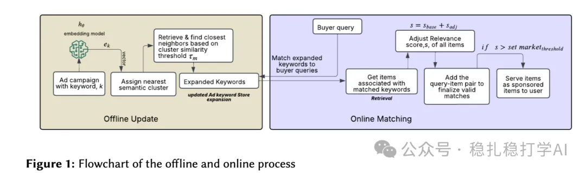

# 推荐算法(2025.5.27)：ebay的关键词召回很实用

> 原文：https://mp.weixin.qq.com/s?__biz=MzkzNDYyNjM1NA==&mid=2247484702&idx=1&sn=d5c348c24be320abedabd30da864f1ed&scene=21#wechat_redirect
> 作者：算法工程师刘明星（稳扎稳打学AI）| 发表于 2025-05-27

嘿，记得给“稳扎稳打学AI”添加星标

关注我，每天为你精选最优质、最新鲜的推荐算法paper，陪你一起保持进步、不断精进！

> [English version](2025-05-27-ebay-keyword-recall.full.en.md)

📄 [本公众号paper推荐原则](https://mp.weixin.qq.com/s?__biz=MzkzNDYyNjM1NA==&mid=2247484097&idx=1&sn=18322c279290b555eb030e12953b7c7f&scene=21#wechat_redirect)

1 Improving Ad matching via Cluster-Adaptive Keyword Expansion and Relevance tuning

网址：https://arxiv.org/pdf/2505.18897

公司：ebay

方向：关键词召回

解读：本研究通过文档端语义关键词扩展来拓宽关键词的覆盖范围，同时保持高相关性。

就是将广告的关键词通过一个学生网络生成对应的embedding，并可以通过ANN搜索出最相似的关键词list作为该关键词的扩展关键词，再通过这个扩展关键词搜索相关的广告，从而提高了广告召回的覆盖范围

ANN搜索是通过一个阈值判断相似集合的，实现了搜索关键词的数量是动态变化的，为了提高召回率稀疏簇相比密集簇有更大的阈值。

具体的方法是离线将所有关键词的embedding做k-means，从而获得每个关键词与最近cluster的关系，并能够根据簇内的分布情况，判断是密集簇，还是稀疏簇，进而判断出每个cluster的召回阈值。

另外，还提到了用gbdt做关键词与广告的相似性分数计算，以及做扩展关键词与广告的相似性bias分数。

心得：

（1）扩展方法并不鲜见。

（2）居然还在用gbdt。只要好用，不用非得追求复杂。

（3）k-means时候生成自适应的阈值，是一个不错的idea，可以应用在其它很多地方。

可信度：生产

推荐等级：有实践价值

请帮忙点赞、转发，谢谢。您认为哪篇论文最有潜力应用到实际业务中？

## 欢迎干货投稿 \ 论文宣传 \ 合作交流

推荐您继续阅读：

■ [推荐算法(2025.5.26)：腾讯、美团的AB效果显著](https://mp.weixin.qq.com/s?__biz=MzkzNDYyNjM1NA==&mid=2247484696&idx=1&sn=52a577d039ccc497941425043935fc25&scene=21#wechat_redirect)

■ [推荐算法(2025.5.23)：Meta的数据增强方法挺有效果](https://mp.weixin.qq.com/s?__biz=MzkzNDYyNjM1NA==&mid=2247484689&idx=1&sn=7ac457c052294726b8fb92e1127630b3&scene=21#wechat_redirect)

■ [推荐算法(2025.5.21)：淘宝的回归预测偏差debias](https://mp.weixin.qq.com/s?__biz=MzkzNDYyNjM1NA==&mid=2247484681&idx=1&sn=24323cbd26f6208cedb928fd8feedc87&scene=21#wechat_redirect)

历史文章索引：https://docs.qq.com/sheet/DYXZTZ0tseHRyZGtt?tab=BB08J2

由于公众号试行乱序推送，您可能不再准时收到稳扎稳打学AI的推送。为了第一时间收到本号的干货内容，请将本号设为星标，以及常点文末右下角的“在看”。

喜欢的话点个在看吧👇

个人观点，仅供参考
