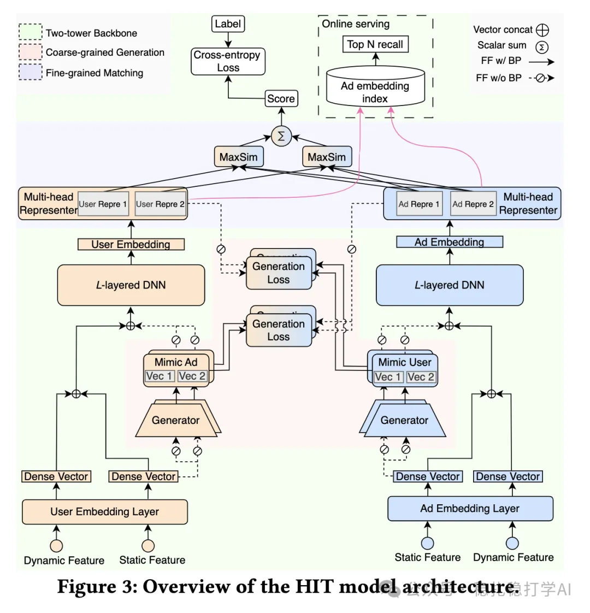

# Recommendation papers (2025.5.30): Tencent's enhanced two-tower pre-ranking works well

> [中文版](2025-05-30-tencent-hit-preranking.md)

1 HIT Model: A Hierarchical Interaction-Enhanced Two-Tower Model for Pre-Ranking Systems

Link: https://arxiv.org/pdf/2505.19849

Company: Tencent

Area: two-tower pre-ranking

Overview:

It can be seen as an upgraded version of Meituan's DAT model: in a two-tower pre-ranking model, each tower uses some information from the other tower to improve itself, indirectly achieving the goal of fusing with the other tower early. Specifically:

(1) Generator network: the user tower (item tower) gets an extra MLP that predicts the item tower's (user tower's) embedding. The embedding the MLP learns is an aggregate representation of all items (users) this user (item) has interacted with. DAT doesn't use an MLP; it uses a standalone learnable embedding. DAT has only one embedding, whereas the generator here is multi-head, because the towers are multi-head. Note that, so as not to affect the main towers, gradient flow back is blocked in many places.

(2) Multi-head representer: projects embeddings into multiple latent subspaces to capture multi-dimensional user interests and ad attributes, enabling fine-grained matching.

The A/B results are strong, so here they are: GMV +1.66%, ROI +1.55%, with serving latency close to the original two-tower model.

Takeaways: the generator acts as a form of clustering. For example, the user tower's generator clusters the representations of all items the user has interacted with.

Credibility: production.

Recommendation: practically useful

