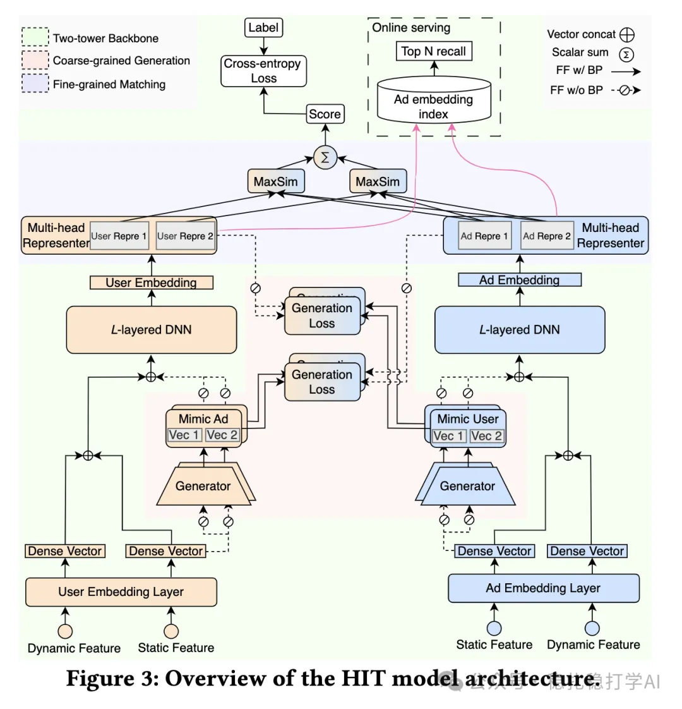

# 推荐算法(2025.5.30)：腾讯的增强双塔粗排有良好效果

> 原文：https://mp.weixin.qq.com/s?__biz=MzkzNDYyNjM1NA==&mid=2247484722&idx=1&sn=e760ad3274d52ff38c471914c19d9404&scene=21#wechat_redirect
> 作者：算法工程师刘明星（稳扎稳打学AI）| 发表于 2025-05-30

嘿，记得给“稳扎稳打学AI”添加星标

关注我，每天为你精挑细选最优质、最新鲜的推荐算法paper，陪你一起保持进步、不断精进！

> [English version](2025-05-30-tencent-hit-preranking.full.en.md)

👆 [本公众号paper推荐原则](https://mp.weixin.qq.com/s?__biz=MzkzNDYyNjM1NA==&mid=2247484097&idx=1&sn=18322c279290b555eb030e12953b7c7f&scene=21#wechat_redirect)

1 HIT Model: A Hierarchical Interaction-Enhanced Two-Tower Model for Pre-Ranking Systems

网址：https://arxiv.org/pdf/2505.19849

公司：腾讯

方向：双塔粗排

解读：

可以看作是美团DAT模型的升级版，就是在双塔粗排模型用对方塔获得一些信息以提高本塔，以间接实现与对方塔中尽早做融合的目的。具体的，

（1）生成网络：用户塔（item塔）增加一个MLP预测item塔（用户塔）的embed，MLP学习的embed都是该用户（item）互动的所有item（用户）的一个综合代表。DAT里没有用MLP，是用一个独立的可学习embed；DAT只有一个embed，但是这里生成器是多头的，因为双塔是多头的。注意，为了不影响主塔，很多地方梯度禁止回传。

（2）多头表示器：将嵌入投影到多个潜在子空间，捕获多维用户兴趣和广告属性，实现细粒度的匹配。

AB优秀，贴一下：实现了商品交易总额（GMV）提升 1.66%、投资回报率（ROI）提升 1.55%，且服务延迟与原始双塔模型相近。

心得：生成器实现了一个聚类的作用。比如用户塔的生成器，就聚类了该用户的所有互动物料表征。

可信度：生产。

推荐等级：有实践价值

请帮忙点赞、转发，谢谢。您认为哪篇论文最有潜力应用到实际业务中？

## 欢迎干货投稿 \ 论文宣传 \ 合作交流

推荐您继续阅读：

■ [推荐算法(2025.5.29)：美团的生成式推荐落地方案](https://mp.weixin.qq.com/s?__biz=MzkzNDYyNjM1NA==&mid=2247484715&idx=1&sn=8471058be40bd73c024774e2d09d3ba2&scene=21#wechat_redirect)

■ [推荐算法(2025.5.28)：美团的一体推荐](https://mp.weixin.qq.com/s?__biz=MzkzNDYyNjM1NA==&mid=2247484708&idx=1&sn=2383a8dd82e93d20404d1f817a4d788a&scene=21#wechat_redirect)

■ [推荐算法(2025.5.27)：ebay的关键词召回很实用](https://mp.weixin.qq.com/s?__biz=MzkzNDYyNjM1NA==&mid=2247484702&idx=1&sn=d5c348c24be320abedabd30da864f1ed&scene=21#wechat_redirect)

历史文章索引：https://docs.qq.com/sheet/DYXZTZ0tseHRyZGtt?tab=BB08J2

由于公众号试行乱序推送，您可能不再准时收到稳扎稳打学AI的推送。为了第一时间收到本号的干货内容， 请将本号设为星标，以及常点文末右下角的“在看”。

喜欢的话点个在看吧👇

个人观点，仅供参考
