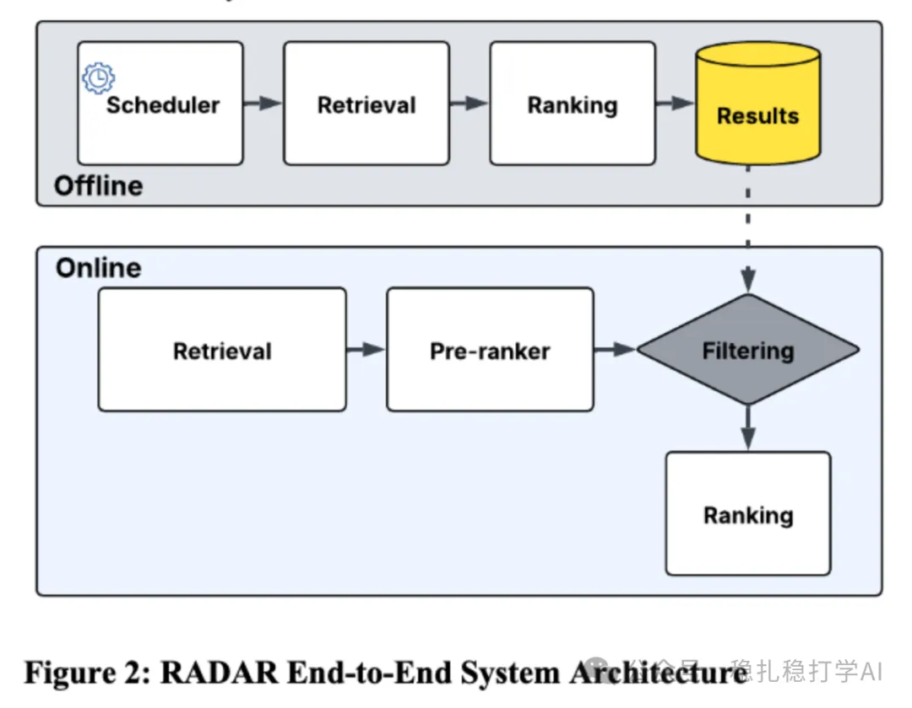

# Recommendation papers (2025.6.10): Meta's new offline retrieval method

> [中文版](2025-06-10-meta-radar.md)

1 RADAR: Recall Augmentation through Deferred Asynchronous Retrieval

Link: https://arxiv.org/pdf/2506.07261

Company: Meta

Area: offline retrieval

Overview:

It proposes a novel hybrid offline-online framework that raises recall by using offline asynchronous computation. Put simply, a ranking model is run offline ahead of time and the results are used online. Specifically:

(1) Offline computation: during off-peak hours, 50x more candidates are retrieved and passed through a ranking model. The top 200 items are taken and cached.

(2) Reranking: in the online integration stage, the top 200 candidates cached by RADAR (stored in a low-latency key-value store) do need to go through the ranking-stage model (the final ranking model) again. The online ranking model re-scores all candidates (from RADAR and from the traditional sources) based on real-time context (such as the user's behavior in the current session and the latest content features) to produce the final ranking. Reason: RADAR's offline candidates are based on the user's historical behavior and long-term interests, and their scores are precomputed during off-peak hours, so they may deviate somewhat from the real-time context of online serving (such as the user's short-term intent or newly uploaded content).

(3) Adaptive scheduling: offline computation is triggered by user activity (highly active users are refreshed daily, less active users weekly or every two weeks) to update the cached top-200 item list.

The A/B results are good, so here they are: user engagement (correlated with long-term retention) +0.8%, unique item consumption +6%, with no added latency and no impact on system stability.

Takeaways:

(1) In China, most people wouldn't dare write an idea like this up as a paper.

(2) The method is very natural, and also very naive.

Credibility: production

Recommendation: practically useful

