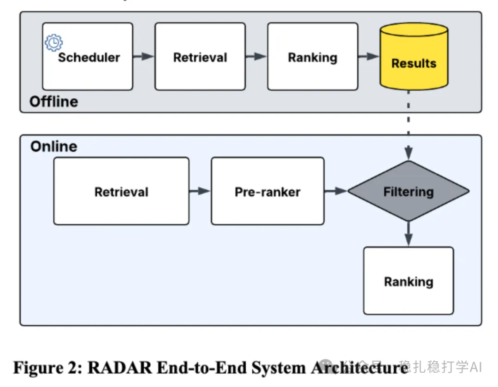

# 推荐算法(2025.6.10)：Meta的离线召回新方法

> 原文：https://mp.weixin.qq.com/s?__biz=MzkzNDYyNjM1NA==&mid=2247484780&idx=1&sn=04d946019642bef0239567c2a1af97e1&scene=21#wechat_redirect
> 作者：算法工程师刘明星（稳扎稳打学AI）| 发表于 2025-06-10

嘿，记得给“稳扎稳打学AI”添加星标

关注我，每天为你精挑细选最优质、最新鲜的推荐算法paper，陪你一起保持进步、不断精进！

> [English version](2025-06-10-meta-radar.full.en.md)

👆 [本公众号paper推荐原则](https://mp.weixin.qq.com/s?__biz=MzkzNDYyNjM1NA==&mid=2247484097&idx=1&sn=18322c279290b555eb030e12953b7c7f&scene=21#wechat_redirect)

1 RADAR: Recall Augmentation through Deferred Asynchronous Retrieval

网址：https://arxiv.org/pdf/2506.07261

公司：Meta

方向：离线召回

解读：

提出了一种新颖的混合离线-在线框架，旨在通过利用离线异步计算提升召回率。简单讲，就是ranking模型离线算好，供在线使用。具体的，

（1）离线计算：非高峰时段，召回数量多50倍，通过一个ranking模型。取top 200 的item，cache下来。

（2）重新排序：在在线集成阶段，RADAR缓存的top 200个候选项目（存储在低延迟键值存储中）确实需要再次通过精排模型（最终排序模型）进行处理。在线精排模型会重新评估所有候选（包括RADAR和传统源的），基于实时的上下文（如用户当前会话的行为、最新内容特征等），生成最终的排序。原因：离线计算的RADAR候选基于用户的历史行为和长期兴趣，评分是在非高峰时段预计算的，可能与在线服务的实时上下文（如用户短期意图、新上传内容）存在一定偏差。

（3）自适应调度：根据用户活跃度（高活跃用户每日刷新，较不活跃用户每周或每两周刷新）触发离线计算，更新cache的top 200 item list。

AB不错，贴一下：用户参与度（与长期留存相关）提升+0.8%，独特项目消费量增加+6%，且未增加延迟或影响系统稳定性。

心得：

（1）在国内，一般人不敢将这样的idea写成paper。

（2）方法很natural，也很naive。

可信度：生产

推荐等级：有实践价值

请帮忙点赞、转发，谢谢。您认为哪篇论文最有潜力应用到实际业务中？

## 欢迎干货投稿 \ 论文宣传 \ 合作交流

推荐您继续阅读：

■ [推荐算法(2025.6.9)：Meta的基于多模态知识蒸馏的I2I方法](https://mp.weixin.qq.com/s?__biz=MzkzNDYyNjM1NA==&mid=2247484773&idx=1&sn=db2b0b912f649427e1e076a8293e301a&scene=21#wechat_redirect)

■ [推荐算法(2025.6.6)：阿里的基于Transformer的推荐系统优化](https://mp.weixin.qq.com/s?__biz=MzkzNDYyNjM1NA==&mid=2247484767&idx=1&sn=6176061ab42a6bd181f669732c24b975&scene=21#wechat_redirect)

■ [推荐算法周报(2025.6.1)：AB效果炸裂的一周](https://mp.weixin.qq.com/s?__biz=MzkzNDYyNjM1NA==&mid=2247484755&idx=1&sn=4110a1a77d2e1b4ad2ebe2a6fe523f44&scene=21#wechat_redirect)

历史文章索引：https://docs.qq.com/sheet/DYXZTZ0tseHRyZGtt?tab=BB08J2

由于公众号试行乱序推送，您可能不再准时收到稳扎稳打学AI的推送。为了第一时间收到本号的干货内容， 请将本号设为星标，以及常点文末右下角的“在看”。

喜欢的话点个在看吧👇

个人观点，仅供参考
