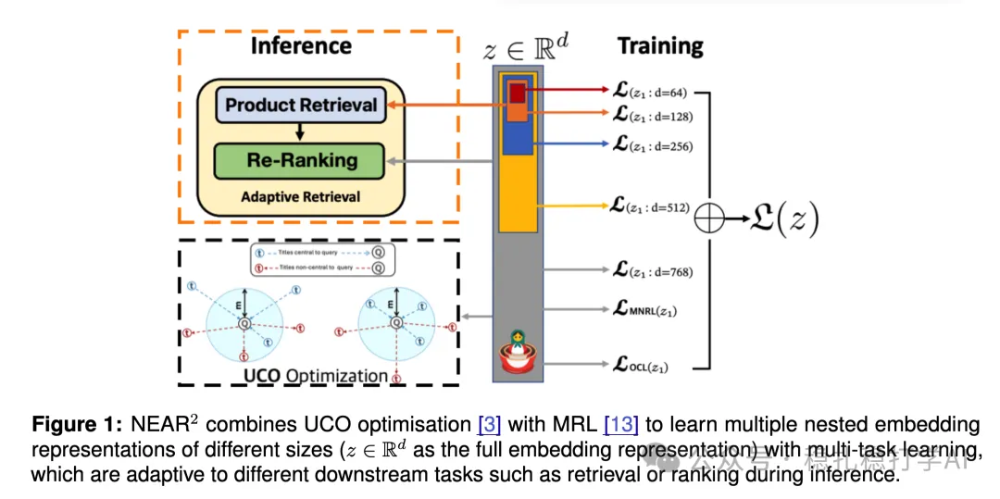

# Recommendation papers (2025.6.25): eBay's Matryoshka representation learning for search is simple and fun

> [中文版](2025-06-25-ebay-near2.md)

1 NEAR2: A Nested Embedding Approach to Efficient Product Retrieval and Ranking

Link: https://arxiv.org/pdf/2506.19743

Company: eBay

Area: search + representation learning

Overview:

A nested embedding method based on Matryoshka Representation Learning (MRL). By optimizing low-dimensional embeddings of several sizes, it can use smaller embedding sizes at inference while keeping performance comparable to the full model. This yields vectors that are trained once and usable for both retrieval and ranking: at inference, retrieval uses a shorter vector (the leading part of the full vector) and ranking uses the longer one.

The nested embeddings are trained by combining MRL with a ranking loss (such as Multiple Negative Ranking Loss, MNRL). MRL optimizes several low-dimensional sub-vectors inside the high-dimensional vector, producing a coarse-to-fine nested representation (see Figure 1). MNRL minimizes the distance between the query and the positive and maximizes the distance to negatives, strengthening the model's discriminative power.

The query, positives and negatives all get their embeddings from Transformer-family models.

Takeaways: Matryoshka representation learning learns, in one go, representations usable for both retrieval and ranking.

Credibility: offline

Recommendation: worth a look

