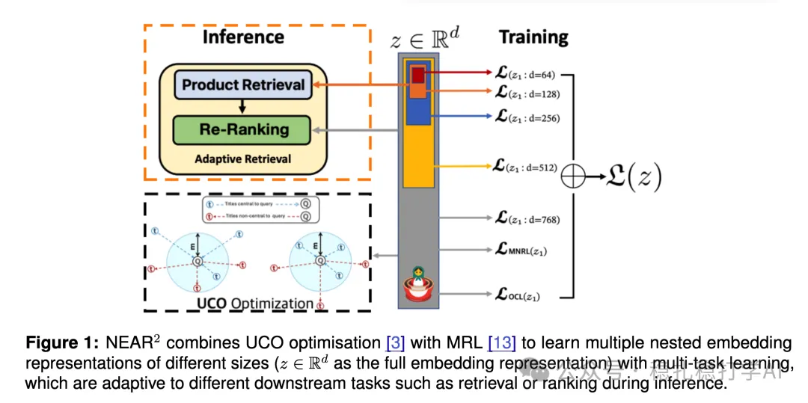

# 推荐算法(2025.6.25)：eBay的搜索套娃表征学习简单有趣

> 原文：https://mp.weixin.qq.com/s/O7fNF9vrStsNm_7baHLEMg
> 作者：算法工程师刘明星（稳扎稳打学AI）| 发表于 2025-06-25

👆 [本公众号paper推荐原则](https://mp.weixin.qq.com/s?__biz=MzkzNDYyNjM1NA==&mid=2247484097&idx=1&sn=18322c279290b555eb030e12953b7c7f&scene=21#wechat_redirect)

1 NEAR2: A Nested Embedding Approach to Efficient Product Retrieval and Ranking

网址：https://arxiv.org/pdf/2506.19743

公司：eBay

方向：搜索+表征学习

解读：

基于 套娃表征（Matryoshka Representation Learning ，MRL) 的嵌套嵌入方法，通过优化不同尺寸的低维嵌入向量，在推理时使用更小的嵌入尺寸，同时保持与全模型相当的性能。这样，获得了同时训练召回、排序都能用到的向量，最后在inference时候，召回用比较短的向量（完整向量的前面部分），排序用较长的那个向量。

结合 MRL 和排名损失（如 Multiple Negative Ranking Loss, MNRL）训练嵌套嵌入。MRL 通过在高维向量中优化多个低维子向量，生成从粗到细的嵌套表示（见图1）。MNRL 通过最小化查询与正样本的距离并最大化与负样本的距离，增强模型区分能力。

query、正样本、负样本都通过Transformer 族模型获取embedding。

心得：套娃表征学习同时学习了可以同时用于召回、排序的表征

可信度：离线

推荐等级：推荐看看

请帮忙点赞、转发，谢谢。您认为哪篇论文最有潜力应用到实际业务中？

## 欢迎干货投稿 \ 论文宣传 \ 合作交流

推荐您继续阅读：

■ [推荐算法(2025.6.24)：沃尔玛的LLM生成标题效果显著](https://mp.weixin.qq.com/s?__biz=MzkzNDYyNjM1NA==&mid=2247484825&idx=1&sn=2db234a57eac403b1865372b431dcaa0&scene=21#wechat_redirect)

■ [推荐算法(2025.6.19)：字节的新物料冷启动方法](https://mp.weixin.qq.com/s?__biz=MzkzNDYyNjM1NA==&mid=2247484819&idx=1&sn=f338e3498d541197be0d4c9c21f9c3b3&scene=21#wechat_redirect)

■ [推荐算法周报(2025.6.15)：Meta独领风骚](https://mp.weixin.qq.com/s?__biz=MzkzNDYyNjM1NA==&mid=2247484811&idx=1&sn=9e7675659d15611cf53e97882b8ebce1&scene=21#wechat_redirect)

历史文章索引：https://docs.qq.com/sheet/DYXZTZ0tseHRyZGtt?tab=BB08J2

由于公众号试行乱序推送，您可能不再准时收到稳扎稳打学AI的推送。为了第一时间收到本号的干货内容， 请将本号设为星标，以及常点文末右下角的“在看”。

喜欢的话点个在看吧👇

个人观点，仅供参考
