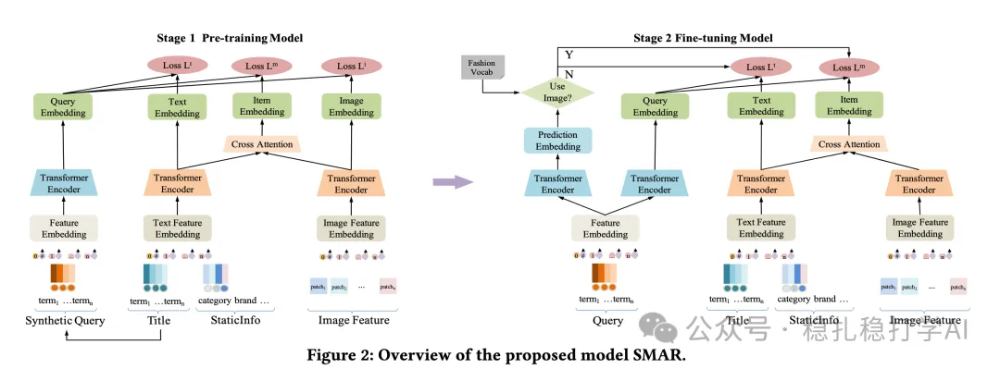

# Recommendation papers (2025.6.26): JD's multimodal search retrieval shows clear gains

> [中文版](2025-06-26-jd-smar.md)

1 Semantic-enhanced Modality-asymmetric Retrieval for Online E-commerce Search

Link: https://arxiv.org/pdf/2506.20330

Multimodal Overview:

At search retrieval time, a fused embedding is computed from the image and the text, and this fused embedding is used for retrieval at ranking time. At the same time, two separate text and image embeddings are trained, and at ranking time the two separate embeddings are used to compute relevance against the query's text embedding. The goal is to make the fused embedding carry both text and image information; if only the fused embedding were used, it would not be trained sufficiently, because a fused embedding easily attends only to the text and ignores the image.

Two stages, pretraining and fine-tuning:

(1) Pretraining: pretrain on text-image pairs. The pretraining objective is to align the query's and the candidate's text, image and text/image fused embeddings.

(2) Fine-tuning: fine-tune on click data from search. In fine-tuning, the input is the query and a candidate product and the output is the click probability. The query embedding is the query's text embedding; the candidate's embedding is the fusion of the product's text embedding and image embedding.

(3) Online deployment: retrieve with the text embedding and the fused embedding. At online inference, first compute the query's text embedding, then retrieve separately with the text embedding and the fused embedding, and merge the retrieval results.

Why not use the fused embedding directly, and instead add a gating network over the prediction embedding to choose between the text embedding and the fused embedding?

A/B: tested on 15% of traffic, SMAR improves GMV and UCVR by +0.285% and +0.174% respectively. In fashion products, GMV +1.112% and UCVR +0.437%, validating SMAR's effectiveness in a commercial setting.

