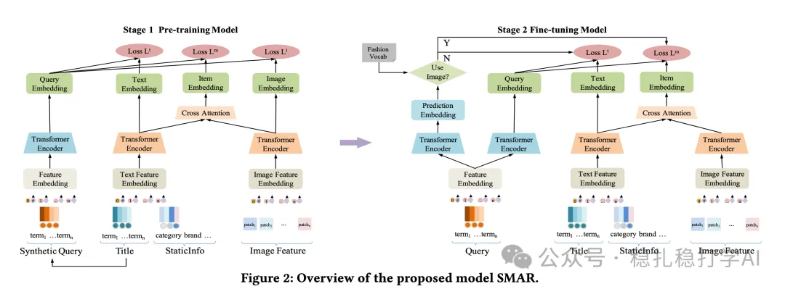

# 推荐算法(2025.6.26)：京东的搜索多模态召回效果明显

> 原文：https://mp.weixin.qq.com/s/Rl91Dg7YtPxa0QXCJoLMQQ
> 作者：算法工程师刘明星（稳扎稳打学AI）| 发表于 2025-06-26（修改于 2025-06-26）

👆 [本公众号paper推荐原则](https://mp.weixin.qq.com/s?__biz=MzkzNDYyNjM1NA==&mid=2247484097&idx=1&sn=18322c279290b555eb030e12953b7c7f&scene=21#wechat_redirect)

1 Semantic-enhanced Modality-asymmetric Retrieval for Online E-commerce Search

网址：https://arxiv.org/pdf/2506.20330

多模态解读：

搜索召回时候，将图片和文本计算融合embedding，排序时候使用这个融合embedding召回；同时训练了2个独立的文本和图片的embedding，排序时候用2个独立的embedding，和query的text embedding计算相关性。这样做的目的是，让融合embedding同时携带文本信息和图片信息；如果只使用融合embedding，融合embedding的训练就不会那么充分，因为融合embedding很容易只关注文本信息，忽略图片信息。

预训练和微调两个阶段：

（1）预训练：使用文本和图片对进行预训练。预训练目标是，对齐query和candiate的文本、图、文本/图融合的embedding。

（2）微调：使用搜索中的点击数据进行微调。微调时，输入是query和候选商品，输出是点击概率。query的embedding是query的文本embedding，候选商品的embedding是商品的文本embedding和图片embedding的融合embedding。

（3）在线部署：使用text embedding和融合embedding进行召回。在线推理时，先计算query的text embedding，然后用text embedding和融合embedding分别召回，再合并召回结果。

为什么不直接用融合的Embedding，要加要加一个prediction embedding的门控网络，选择是使用text embedding，还是融合embedding？

贴AB：在15%流量上测试，SMAR在GMV和UCVR上分别提升+0.285%和+0.174%。在时尚类商品中，GMV提升+1.112%，UCVR提升+0.437%，验证了SMAR在商业场景中的有效性。

请帮忙点赞、转发，谢谢。您认为哪篇论文最有潜力应用到实际业务中？

## 欢迎干货投稿 \ 论文宣传 \ 合作交流

推荐您继续阅读：

■ [推荐算法(2025.6.25)：eBay的搜索套娃表征学习简单有趣](https://mp.weixin.qq.com/s?__biz=MzkzNDYyNjM1NA==&mid=2247484831&idx=1&sn=6795d2f305b16b5cbcb18d5e58e8ea8b&scene=21#wechat_redirect)

■ [推荐算法(2025.6.24)：沃尔玛的LLM生成标题效果显著](https://mp.weixin.qq.com/s?__biz=MzkzNDYyNjM1NA==&mid=2247484825&idx=1&sn=2db234a57eac403b1865372b431dcaa0&scene=21#wechat_redirect)

■ [推荐算法(2025.6.19)：字节的新物料冷启动方法](https://mp.weixin.qq.com/s?__biz=MzkzNDYyNjM1NA==&mid=2247484819&idx=1&sn=f338e3498d541197be0d4c9c21f9c3b3&scene=21#wechat_redirect)

历史文章索引：https://docs.qq.com/sheet/DYXZTZ0tseHRyZGtt?tab=BB08J2

由于公众号试行乱序推送，您可能不再能收到稳扎稳打学AI的推送。为了第一时间收到本号的干货内容，请将本号设为星标，以及常点文末右下角的“在看”。

喜欢的话点个在看吧👇

个人观点，仅供参考

修改于2025年6月26日
