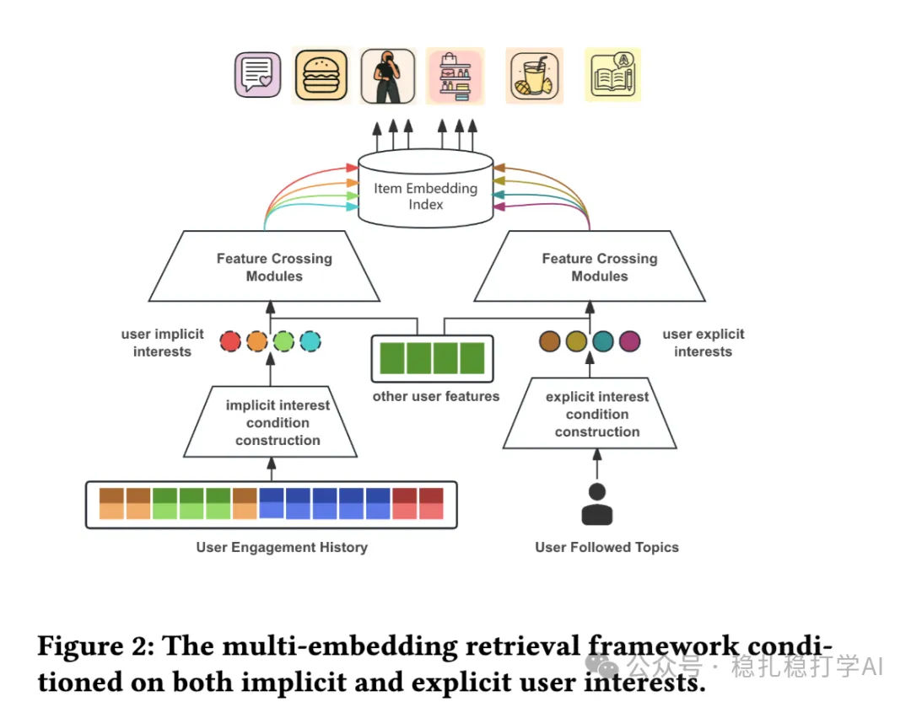

# Recommendation papers (2025.7.1): Pinterest's interest-clustering retrieval

> [中文版](2025-07-01-pinterest-interest-clustering.md)

1 Synergizing Implicit and Explicit User Interests: A Multi-Embedding Retrieval Framework at Pinterest

Link: https://arxiv.org/pdf/2506.19648

Company: Pinterest

Area: retrieval

Overview:

Background: traditional retrieval methods mainly rely on users' implicit interests, i.e. the interests reflected in their historical behavior. But user interests are multifaceted, including both implicit interests (shown through behavior) and explicit interests (interests users express actively, such as followed topics and saved content). Pinterest's work proposes a multi-embedding retrieval framework that combines implicit and explicit user interests to improve retrieval.

Core idea: the framework models implicit and explicit interests as separate embedding vectors and uses them together during retrieval, capturing user interests more comprehensively. Specifically:

(1) Implicit interest modeling: extract implicit interest embeddings from the user's historical behavior sequence. These embeddings reflect the interests the user shows through browsing, clicking, saving and similar actions.

(2) Explicit interest modeling: build explicit interest embeddings from interests the user expresses actively (such as followed topics and saved boards). These embeddings directly reflect the user's clear preferences.

(3) Multi-embedding retrieval: at the retrieval stage, the system uses both implicit and explicit interest embeddings, retrieves relevant candidates with each, and merges the results. This joint retrieval covers a broader range of user interests and improves the diversity and accuracy of retrieval.

(4) Interest clustering: on top of multi-embedding retrieval, the system clusters the user's interests, grouping similar interests together to further improve retrieval efficiency and quality. Through clustering, the system can identify the user's main interest areas and recommend in a targeted way.

A/B: in Pinterest's online experiments, the framework raised the CTR of related recommendations by 3.2% and also improved recommendation diversity. The experiments show that introducing explicit interests noticeably improves users' satisfaction with the recommended content.

Takeaways: (1) Modeling implicit and explicit interests together is an effective way to improve retrieval, especially through multi-embedding retrieval, which captures user interests more comprehensively. (2) Applying interest clustering in retrieval can further improve retrieval efficiency and is worth trying in real business.

Credibility: production

Recommendation: practically useful

