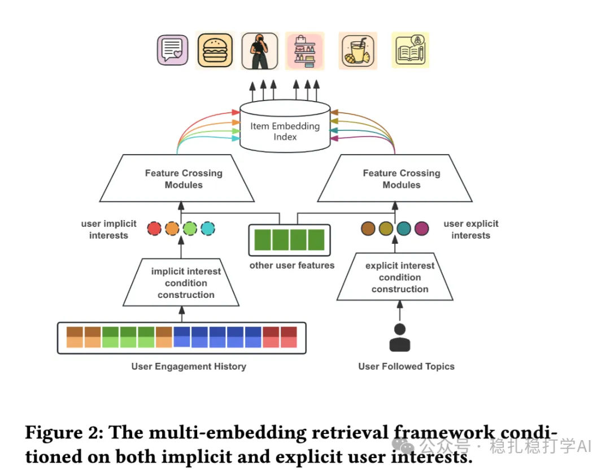

# 推荐算法(2025.7.1)：Pinterest的兴趣聚类召回

> 原文：https://mp.weixin.qq.com/s?__biz=MzkzNDYyNjM1NA==&mid=2247484867&idx=1&sn=33c9c879ca6f9282601c2709750f69dc&scene=21#wechat_redirect
> 作者：算法工程师刘明星（稳扎稳打学AI）| 发表于 2025-07-01

嘿，记得给“稳扎稳打学AI”添加星标

关注我，每天为你精挑细选最优质、最新鲜的推荐算法paper，陪你一起保持进步、不断精进！

👆 [本公众号paper推荐原则](https://mp.weixin.qq.com/s?__biz=MzkzNDYyNjM1NA==&mid=2247484097&idx=1&sn=18322c279290b555eb030e12953b7c7f&scene=21#wechat_redirect)

1 Synergizing Implicit and Explicit User Interests: A Multi-Embedding Retrieval Framework at Pinterest

网址：https://arxiv.org/pdf/2506.19648

公司：Pinterest

方向：召回

解读：

背景：传统的召回方法主要依赖用户的隐式兴趣，即用户历史行为所反映的兴趣。然而，用户兴趣是多面的，既包含隐式兴趣（通过行为体现），也包含显式兴趣（用户主动表达的兴趣，如关注的主题、收藏的内容等）。Pinterest的研究提出了一种多嵌入检索框架，协同隐式和显式用户兴趣，以提升召回效果。

核心思想：该框架通过将隐式兴趣和显式兴趣分别建模为不同的嵌入向量，并在检索过程中协同使用，从而更全面地捕捉用户兴趣。具体包括：

（1）隐式兴趣建模：通过用户历史行为序列，提取用户的隐式兴趣嵌入。这些嵌入反映了用户在浏览、点击、保存等行为中表现出的兴趣。

（2）显式兴趣建模：通过用户主动表达的兴趣（如关注的主题、收藏的板块等），构建显式兴趣嵌入。这些嵌入直接反映了用户的明确偏好。

（3）多嵌入检索：在检索阶段，系统同时使用隐式和显式兴趣嵌入，分别检索相关的候选物品，并将结果合并。这种协同检索方式能够覆盖更广泛的用户兴趣，提高召回的多样性和准确性。

（4）兴趣聚类：在多嵌入检索的基础上，系统对用户的兴趣进行聚类，将相似的兴趣归为一类，从而进一步优化检索效率和效果。通过聚类，系统可以识别出用户的主要兴趣领域，并针对性地进行推荐。

贴AB：在Pinterest的在线实验中，该框架使相关推荐的点击率提升了3.2%，同时提高了推荐的多样性。实验表明，显式兴趣的引入显著提升了用户对推荐内容的满意度。

心得：（1）将隐式兴趣和显式兴趣协同建模，是提升召回效果的有效方法。特别是通过多嵌入检索，可以更全面地捕捉用户兴趣。（2）兴趣聚类在召回中的应用，能够进一步优化检索效率，值得在实际业务中尝试。

可信度：生产

推荐等级：有实践价值

请帮忙点赞、转发，谢谢。您认为哪篇论文最有潜力应用到实际业务中？

## 欢迎干货投稿 \ 论文宣传 \ 合作交流

推荐您继续阅读：

■ [推荐算法(2025.6.30)：DCN模型的第三版效果不错](https://mp.weixin.qq.com/s?__biz=MzkzNDYyNjM1NA==&mid=2247484859&idx=1&sn=3878da8ba0a3b059a6f1a45888b9f4b3&scene=21#wechat_redirect)

■ [推荐算法(2025.6.29)：本周4篇，效果都不错](https://mp.weixin.qq.com/s?__biz=MzkzNDYyNjM1NA==&mid=2247484855&idx=1&sn=6a3fb2e1a6f0c5e3b0e5d02b8c90e9b&scene=21#wechat_redirect)

■ [推荐算法(2025.6.28)：Spotify的混流排序非常有效](https://mp.weixin.qq.com/s?__biz=MzkzNDYyNjM1NA==&mid=2247484849&idx=1&sn=f7a9e14d8eaf5f2c1cba7a9b2d4d0c6&scene=21#wechat_redirect)

历史文章索引：https://docs.qq.com/sheet/DYXZTZ0tseHRyZGtt?tab=BB08J2

由于公众号试行乱序推送，您可能不再准时收到稳扎稳打学AI的推送。为了第一时间收到本号的干货内容， 请将本号设为星标，以及常点文末右下角的“在看”。

喜欢的话点个在看吧👇

个人观点，仅供参考
