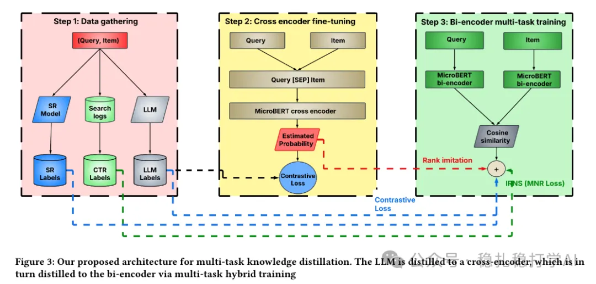

# Recommendation papers (2025.8.6): eBay's two-tower model, a small LLM application with big results

> [中文版](2025-08-06-ebay-llm-two-tower.md)

1 LLM-Enhanced Two-Tower Model for Advertising Retrieval

Link: https://arxiv.org/pdf/2508.03427

Company: eBay

Area: LLM distillation + two-tower

Overview:

A small LLM application: it is mainly used to judge the relevance of (query, item) pairs, and that judgment is then distilled as knowledge into smaller models (Cross Encoder, Bi-Encoder).

That is, an LLM scores relevance, filters noisy data, and guides two-tower learning. The LLM does not optimize the two-tower parameters directly; it provides data cleaning and labels, indirectly optimizing the two-tower training objective. The approach:

(1) Use a small cross encoder model (MicroBERT) to predict the CTR score of (query, item) pairs, trained as a CTR classifier. The predicted score serves as the teacher's judgment and is used to train the bi-encoder.

(2) Use an LLM to score (query, item) relevance, with the prompt: Given an item with title: '{title}' determine whether the keyphrase: '{keyphrase}', is relevant for cnc targeting or not by giving: ONLY yes or no answer.. This is a judgment on the SR labels.

(3) The cross encoder is trained on 3 kinds of data:

① CTR classification based on SR labels.

② The LLM's judgment (yes/no) of (query, item) relevance.

③ Knowledge distillation loss: a similarity loss between the outputs of the Cross Encoder and the Bi-Encoder, pulling the Bi-Encoder toward the Cross Encoder.

For the data from these 3 sources, each batch holds data from a different source.

(4) The final bi-encoder is trained with these losses:

(1) MNR: i.e. in-batch negative sampling, for the CTR labels.

(2) InfoNCE: for the SR/LLM contrastive labels.

(3) Knowledge distillation loss: Pearson Correlation (batch-level rank imitation).

A/B results: a 12-day A/B test in the US market:

(1) GMB (gross merchandise bought, i.e. sales) +51.26%;

(2) ROAS (return on ad spend = GMB / ad revenue) +38.69% (p=0.02).

Takeaways:

(1) A good way to apply an LLM's understanding ability: use the LLM as a reviewer. My guess is they had no human reviewers checking (query, item) relevance before. Even if they had hired people, the accuracy would not be as good as the LLM's.

(2) Training on multiple data sources makes several objectives compatible.

Credibility: production

Recommendation: practically useful

