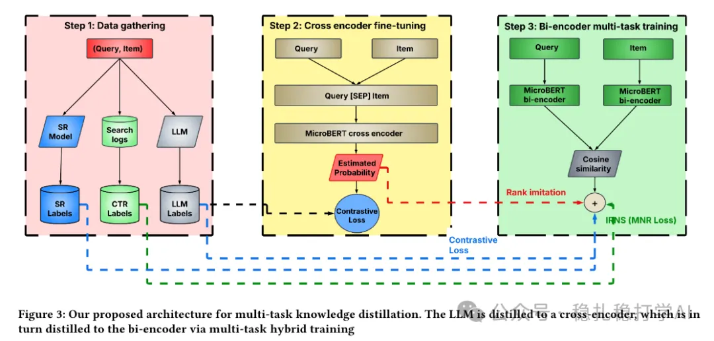

# 推荐算法(2025.8.6)：eBay双塔，小小的LLM应用，开出大大的花

> 原文：https://mp.weixin.qq.com/s/bRxQ16v9qLVRzcvamWGZ6A
> 作者：算法工程师刘明星（稳扎稳打学AI）| 发表于 2025-08-06（标题已修改；修改于 2025-08-06）

嘿，记得给“稳扎稳打学AI”添加星标

关注我，每天为你精挑细选最优质、最新鲜的推荐算法paper，陪你一起保持进步、不断精进！

> [English version](2025-08-06-ebay-llm-two-tower.full.en.md)

👆 [本公众号paper推荐原则](https://mp.weixin.qq.com/s?__biz=MzkzNDYyNjM1NA==&mid=2247484097&idx=1&sn=18322c279290b555eb030e12953b7c7f&scene=21#wechat_redirect)

1 LLM-Enhanced Two-Tower Model for Advertising Retrieval

网址：https://arxiv.org/pdf/2508.03427

公司：ebay

方向：LLM蒸馏+双塔

解读：

小小的LLM应用，主要用于判断（query，item）对的相关性，然后作为蒸馏知识，教给小模型（Cross Encoder、Bi-Encoder）。

就是用大型语言模型LLM做相关性打分，过滤噪声数据，指导双塔学习。LLM不是直接优化双塔的参数的，而是提供数据清洗、标签，间接优化双塔学习的目标。具体做法是：

（1）使用一个小版本的cross encoder模型（MicroBERT），预测（query，item）对的CTR分数，训练成CTR分类器。预测分数作为teacher的判断，并用此训练bi-encoder。

（2）使用LLM对（query，item）相关性打分，提示词为：Given an item with title: '{title}' determine whether the keyphrase: '{keyphrase}', is relevant for cnc targeting or not by giving: ONLY yes or no answer.。是对SR标签的判断。

（3）对cross encoder的训练，通过3个数据进行训练：

①基于SR标签的CTR分类。

②基于LLM对（query，item）相关性的判断（yes/no）。

③基于知识蒸馏损失：计算Cross Encoder和Bi-Encoder输出结果之间的相似度损失，使Bi-Encoder向Cross Encoder看齐。

对前3多个数据源的数据，每个batch不同的数据源数据。

（4）对最终的bi-encoder的训练，使用损失函数包括：

（1）MNR：就是in-batch negative sampling，针对CTR标签。

（2）InfoNCE：针对SR/LLM对比标签。

（3）知识蒸馏损失：Pearson Correlation（批次级排名模仿）。

A/B效果：在美国市场开展了一项为期 12 天的 A/B 测试，

（1）商品交易总额（GMB，即销售额）提高 51.26%；

（2）广告投资回报率（ROAS = 商品交易总额 / 广告收入）提升38.69%（p=0.02）。

心得：

（1）LLM理解能力应用的好做法。把LLM当审核员来用，我猜之前没有请审核员来审核（query，item）相关性。即使请人做了，准确率也不如LLM。

（2）多数据源训练实现了多种目标的兼容。

可信度：生产

推荐等级：有实践价值

请帮忙点赞、转发，谢谢。您认为哪篇论文最有潜力应用到实际业务中？

## 欢迎干货投稿 \ 论文宣传 \ 合作交流

推荐您继续阅读：

■ [推荐算法(2025.8.5)：淘宝的物料冷启动，使用“群组信息增强”取得巨大效果](https://mp.weixin.qq.com/s/92DARCpzTOZCX-UTgz29Eg)

■ [推荐算法(2025.8.4)：美团的大模型助力新颖性推荐，AB效果不错哈](https://mp.weixin.qq.com/s/BvdEgX02zTyB1RqnuWi3Xw)

■ [推荐算法(2025.8.1)：阿里如何将LLM在推荐系统上全面落地](https://mp.weixin.qq.com/s/p7c5eHZWVbvf2Wa_LuZadA)

历史文章索引：https://docs.qq.com/sheet/DYXZTZ0tseHRyZGtt?tab=BB08J2

请入微信群，群内我会给出更深入的解读，还可以共同讨论技术方案、发招聘广告、内推和交友等。

• 铁粉标准：关注一个月以上，且累计10次互动（评论、爱心、转发）、投稿1次。

• 入群方法：请您加个人微信lmxhappy，我拉您入群，请备注（只我个人看，不公开）。

由于公众号试行乱序推送，您可能不再准时收到稳扎稳打学AI的推送。为了第一时间收到本号的干货内容， 请将本号设为星标，以及常点文末右下角的“在看”。

喜欢的话点个在看吧👇

个人观点，仅供参考

修改于 2025-08-06
