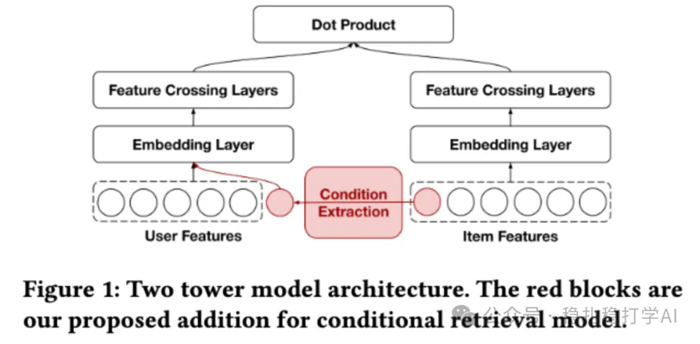

# Recommendation papers (2025.8.27): Pinterest's conditional retrieval, simple and effective

> [中文版](2025-08-27-pinterest-conditional-retrieval.md)

1 Bootstrapping Conditional Retrieval for User-to-Item Recommendations

Link: https://arxiv.org/pdf/2508.16793

Company: Pinterest

Area: retrieval (conditional retrieval)

Overview:

Train one model that retrieves items for a user under different conditions: a constrained retrieval for the user. The method is simple: put the condition into the user tower and train it the way you normally train a two-tower model, on the full sample set. At inference, feed in the condition you want (one that was used in training) and retrieve.

At Pinterest, users regularly receive personalized content recommendations via email or push notifications. In Pinterest's topic push, the topic is a condition. Implementation:

(1) Condition extraction module: generates a single condition from item metadata or features for the user tower to use. This module is independent of the two-tower model and depends on the features and the condition. For example, in the topic push use case, it uses the existing item-to-topic mapping and randomly samples one topic from the set of topics the item belongs to.

(2) Conditional user tower: the user tower is modified to encode the condition at the embedding layer. The condition embedding goes into the feature-crossing layer, encouraging high-order interactions between user and condition. That is, the output of the condition extraction module is concatenated with the user embedding and then feature-crossed.

A/B: the model has been deployed in Pinterest's topic notification push, giving +0.26% weekly active users (WAU).

Takeaways:

Conditional retrieval, through the conditions you feed in, enables retrieval from multiple angles, and can also be applied in different scenarios. The method is simple and practical.

Credibility: production

Recommendation: practically useful

