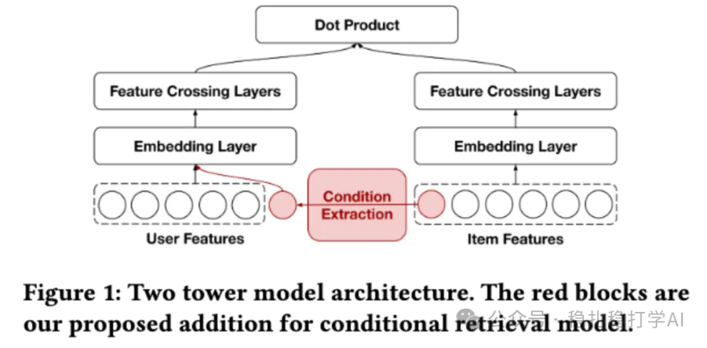

# 推荐算法(2025.8.27)：Pinterest的条件召回，简单有效

> 原文：https://mp.weixin.qq.com/s/iwYRuGuSWo4AsEAyxkY5TA
> 作者：算法工程师刘明星（稳扎稳打学AI）| 发表于 2025-08-27

嘿，记得给“稳扎稳打学AI”添加星标

关注我，每天为你精挑细选最优质、最新鲜的推荐算法paper，陪你一起保持进步、不断精进！

👆 [本公众号paper推荐原则](https://mp.weixin.qq.com/s?__biz=MzkzNDYyNjM1NA==&mid=2247484097&idx=1&sn=18322c279290b555eb030e12953b7c7f&scene=21#wechat_redirect)

1 Bootstrapping Conditional Retrieval for User-to-Item Recommendations

网址：https://arxiv.org/pdf/2508.16793

公司：Pinterest

方向：召回（条件召回）

解读：

训练一个模型，实现user在不同条件下召回物料，是一种对user的限制性召回。方法很简单，就是将条件放到user tower里，按照正常的训练双塔的方法训练，样本是全量样本。在推理的时候，输入想要的条件（包含在训练时候用到的），做召回。

在Pinterest用户定期收到个性化内容推荐的电子邮件或推送通知。Pinterest的主题推送，topic就是一个condition。具体实现，

（1）条件提取模块：从物品元数据或特征中生成单一条件，供用户塔使用。该模块独立于双塔模型，视特征和条件而定。例如，在主题推送用例中，利用现有物品到主题映射，从物品所属主题集中随机采样一个主题。

（2）条件用户塔：修改用户塔，在嵌入层编码条件。条件嵌入与特征交叉层，促进用户与条件的高阶交互。即将条件提取模块的输出跟user embed拼接后做特征交叉。

AB：该模型已部署到Pinterest的主题通知推送中，导致每周活跃用户（WAU）提升+0.26%。

心得：

条件召回，可以输入的条件，实现多个角度的召回，也可以应用在不同的场景下。该方法简单实用。

可信度：生产

推荐等级：有实践价值

请帮忙点赞、转发，谢谢。您认为哪篇论文最有潜力应用到实际业务中？

## 欢迎干货投稿 \ 论文宣传 \ 合作交流

推荐您继续阅读：

■ [推荐算法(2025.8.26)：Spotify用大模型分析视频内容](https://mp.weixin.qq.com/s/rxIoz-T7eEy9IR3yuk2P3w)

■ [推荐算法(2025.8.24)：阿里的长行为序列建模](https://mp.weixin.qq.com/s/MEqTzLzRXp5TdNNvL1kybA)

历史文章索引：https://docs.qq.com/sheet/DYXZTZ0tseHRyZGtt?tab=BB08J2

请入微信群，群内我会给出更深入的解读，还可以共同讨论技术方案、发招聘广告、内推和交友等。

• 铁粉标准：关注一个月以上，且累计10次互动（评论、爱心、转发）、或投稿1次。

• 入群方法：请您加个人微信lmxhappy，我拉您入群，请备注（只我个人看，不公开）。

喜欢的话点个在看吧👇

个人观点，仅供参考
