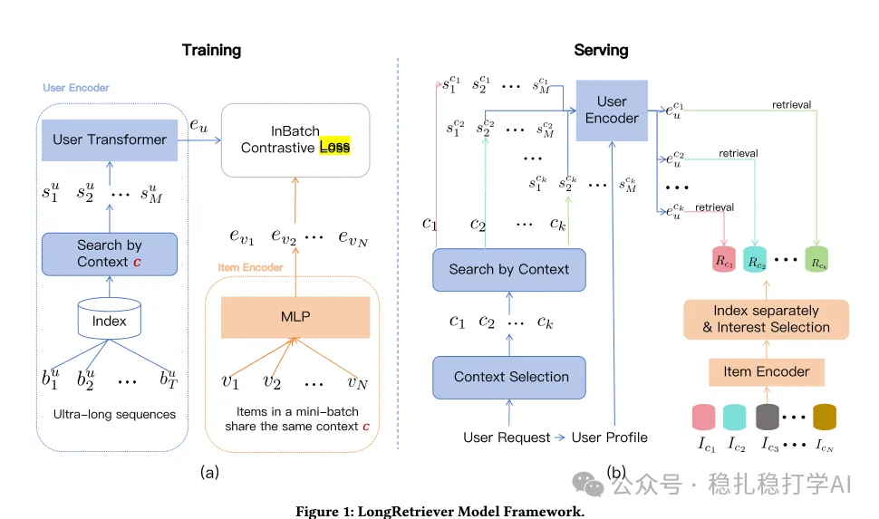

# Recommendation papers (2025.9.11): ByteDance's two-tower retrieval lets the behavior sequence cross with the item, with clear gains

> [中文版](2025-09-11-bytedance-longretriever.md)

1 LongRetriever: Ultra-Long Sequential Modeling for Candidate Retrieval via a Single Encoder

Link: https://www.arxiv.org/pdf/2508.15486v2

Company: ByteDance

Area: retrieval

Overview: two-tower retrieval where the behavior sequence crosses with the item.

(1) User tower

On the user tower side, for the lifelong behavior sequence, a hard search by the candidate item's category produces a subsequence. Together with [CLS], user profile features, position encodings and type embeddings, it is fed into a Transformer, and the [CLS] output is used as the user embedding.

(2) Item tower

The item tower also uses a Transformer, except its input is only the item's feature sequence and [CLS], which gives the item embedding.

(3) Training

The (user, item) pairs are all positives; negatives come from in-batch negative sampling. An important insight here is that this setup has a data leakage problem: the filtered subsequence is of the same category as the item, while most negatives are not of the same category, so the model can easily take a shortcut and decide whether a sample is positive by category.

Fix: also put the item into the user tower and mask it during training. In addition, add randomly sampled data as a control for the negatives.

(4) Inference

After the user tower is trained, one user embedding is precomputed per category. At inference, the user embedding for the item's category is selected and its inner product with the item embedding is computed directly.

A/B: on Douyin, retrieval efficiency improved 100x, AUC went up, and retrieval hit rate went up.

Takeaways: (1) What attracted me most in this paper is using the filtered behavior sequence to build the user embedding, which made me understand a new paradigm for two-tower retrieval. (2) The paper also proposes some innovative ideas, such as precomputation, the negative sampling strategy and position encoding, all with good practical effect.

Credibility: production

Recommendation: practically useful

