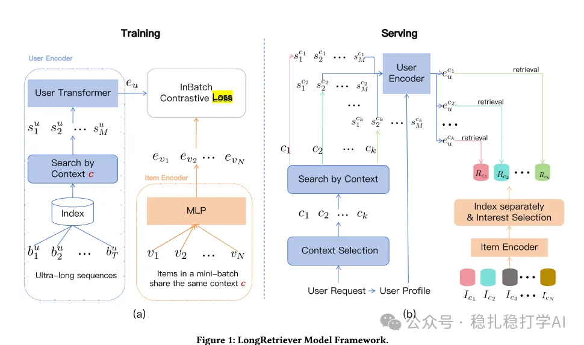

# 推荐算法(2025.9.11)：字节的双塔召回，行为序列与item可以做交叉，效果显著

> 原文：https://mp.weixin.qq.com/s/x8pMwhZRTvJuqwvlWt4Onw
> 作者：算法工程师刘明星（稳扎稳打学AI）| 发表于 2025-09-11

嘿，记得给“稳扎稳打学AI”添加星标

关注我，每天为你精挑细选最优质、最新鲜的推荐算法paper，陪你一起保持进步、不断精进！

> [English version](2025-09-11-bytedance-longretriever.full.en.md)

👆 [本公众号paper推荐原则](https://mp.weixin.qq.com/s/BhVGu0qH5kTz9N5zpsD3KA)

1 LongRetriever: Ultra-Long Sequential Modeling for Candidate Retrieval via a Single Encoder

网址：https://www.arxiv.org/pdf/2508.15486v2

公司：字节

方向：召回

解读：双塔召回，行为序列与item做交叉。

（1）user塔

在user塔侧针对终身行为序列，根据candidate item的category做hard search获得一个子序列，连同 [CLS] 、用户 profile 特征、位置编码和类型嵌入，输入Transformer模型，输出 [CLS] 表征作为user的embed。

（2）item塔

在item塔侧同样使用Transformer模型，只不过输入只有其特征序列和[CLS]，从而获得item的embed。

（3）训练

（user，item）对都是正样本，负样本就是in-batch negative sampling。这里提出了一个重要的insight，就是这样做有一个数据泄漏的问题。即过滤剩下的子序列与item是同类别，负样本大都不是同类别，通过模型就容易偷懒，根据类别来判别是否是正样本。

解决办法：把item也放到user塔里，训练的时候就对这个item做mask处理。另外，增加一个随机采样的数据，作为负样本的对照。

（4）预估

训练好user塔后，针对每一个类别预计算一个user embed，预估的时候根据item的类别选择对应的user embed，然后直接与item embed做内积。

AB：抖音上，召回效率提升100倍、AUC提升、召回的命中率提升。

心得：（1）本文最吸引我的是用过滤后的行为序列做user的embed，让我理解了双塔召回的新范式。（2）本文还提出了一些创新的思路，如预计算、负采样策略、位置编码等，都有很好的实际效果。

可信度：生产

推荐等级：有实践价值

请帮忙点赞、转发，谢谢。您认为哪篇论文最有潜力应用到实际业务中？

## 欢迎干货投稿 \ 论文宣传 \ 合作交流

推荐您继续阅读：

■ [推荐算法(2025.9.10)：阿里的会话生成式推荐，召回效果显著](https://mp.weixin.qq.com/s/_o--mIENrTLr123_9KCFCA)

■ [推荐算法(2025.9.9)：快手的生成式搜索推荐，号称史上最大提升](https://mp.weixin.qq.com/s/i9yHQgxZ4QdK8PsgkJarng)

历史文章索引：https://docs.qq.com/sheet/DYXZTZ0tseHRyZGtt?tab=BB08J2

请入微信群，群内我会给出更深入的解读，还可以共同讨论技术方案、发招聘广告、内推和交友等。

• 铁粉标准：关注一个月以上，且累计10次互动（评论、爱心、转发）、或投稿1次。

• 入群方法：请您加个人微信lmxhappy，我拉您入群，请备注（只我个人看，不公开）。

喜欢的话点个在看吧👇

个人观点，仅供参考
