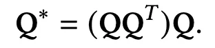
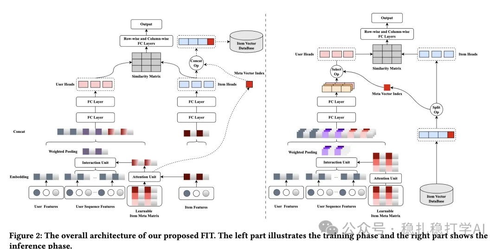
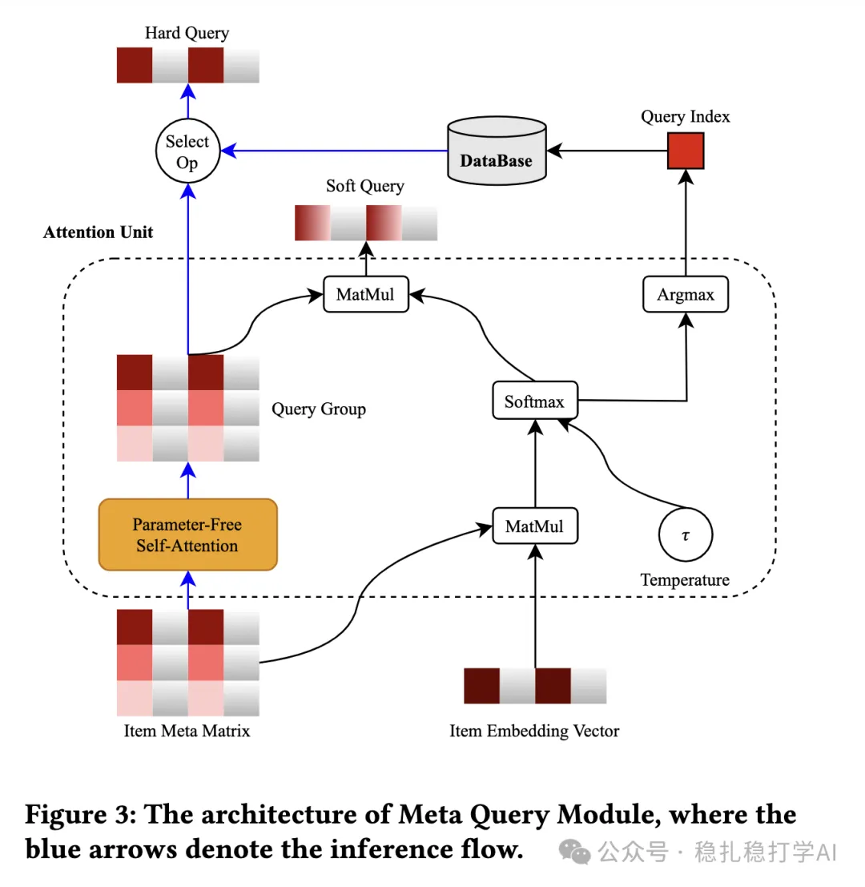

# Recommendation papers (2025.9.18): Ant Group's two-tower pre-ranking, with k-means clustering helping the user tower

> [中文版](2025-09-18-ant-two-tower-preranking.md)

1 A Learnable Fully Interacted Two-Tower Model for Pre-Ranking System

Link: https://arxiv.org/pdf/2509.12948

Company: Ant Group

Area: pre-ranking + early interaction + late interaction

Overview:

Early interaction and late interaction in a two-tower model. Briefly, early interaction means that in the user tower, the item's cluster stands in for the item in sequence modeling. Specifically, an item cluster matrix is maintained, and the cluster embedding most similar to the candidate item is used with the behavior sequence for user interest modeling. The nice part is that at inference this can be computed in advance, described below. Late interaction passes the multiple embeddings from the user tower and the item tower through MLPs, with some simple, special handling.

(1) Item meta matrix

That is, the item cluster matrix: a clustering matrix of items is maintained, where rows are cluster centers and columns are feature dimensions. Specifically, a weight matrix is maintained with one row per item cluster. The embedding of the cluster most similar to the candidate item is called the hard query; weights obtained via softmax are used to take a weighted sum over all cluster embeddings, and that embedding is called the soft query. Note that the index of the most similar cluster is stored in the database along with the candidate item, for use at inference.

In particular, the paper does not use the weight matrix directly (the paper calls it the item meta matrix, denoted Q), but applies an operation to it:

The result has the same shape as Q, and both queries finally used, hard and soft, come from this result matrix (the paper calls it the Query Group). The paper says the main purpose is to speed up the convergence of the item meta matrix Q's parameters.

(2) Early interaction

In the user tower, the candidate item's hard query and soft query are each used with the behavior sequence for interest modeling. Specifically: the hard query with the behavior sequence gives the hard interest representation; the soft query with the behavior sequence gives the soft interest representation.

(3) Late interaction

The outputs of the user tower and the item tower each go through an MLP and then an inner product gives the final score. Specifically: the user tower output goes through an MLP to get the user representation; the item tower output goes through an MLP to get the item representation; then the inner product of the user and item representations gives the final score.

(4) Inference

At inference, all rows of the whole Query Group (hard queries) take part in the user tower computation: each hard query does interest modeling with the user behavior sequence separately (e.g. DIN-style weighted pooling), producing N user representations. Then, according to the item's query index s, only the corresponding z^{(s)}_u is selected to compute the similarity matrix and the output score.

Takeaways: (1) The idea of this paper is very simple and direct: use an item cluster matrix to implement early and late interaction in a two-tower model. The benefit is that it improves the two-tower model without adding much computation. (2) The hard query and soft query in this paper are also well worth borrowing: the hard query picks the most similar cluster, while the soft query gets a richer representation through weighting.

Caveats: none

Credibility: production

Recommendation: practically useful

