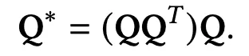
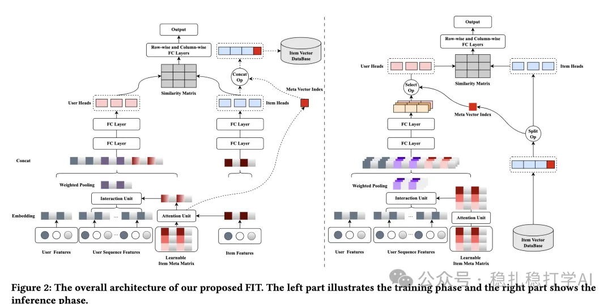
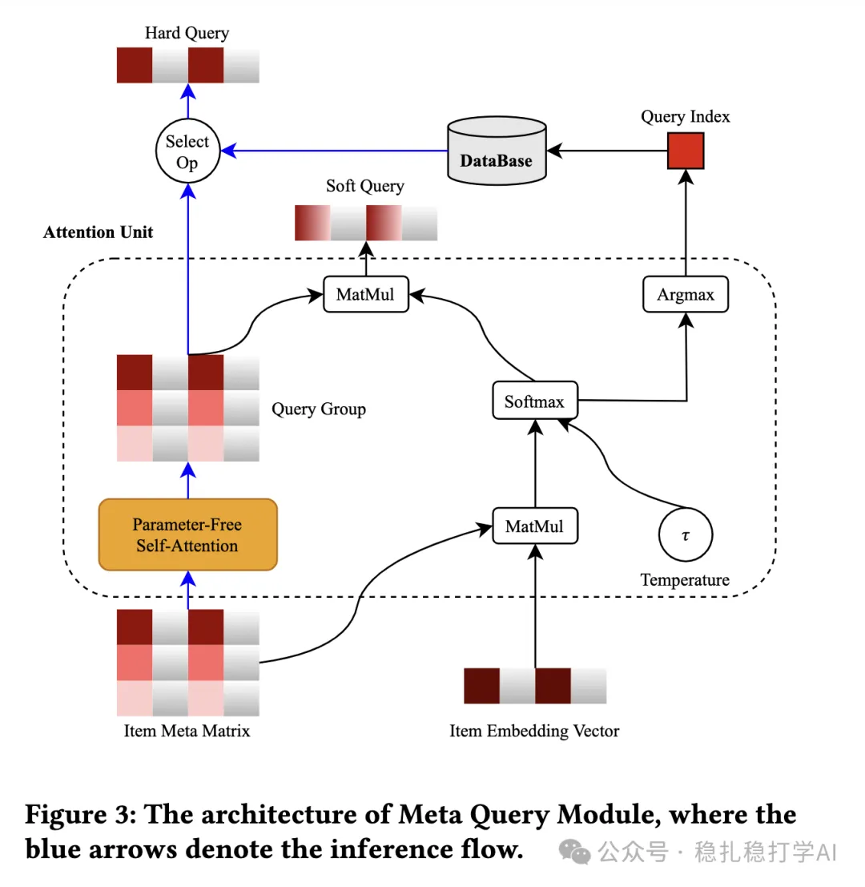

# 推荐算法(2025.9.18)：蚂蚁的双塔粗排，kmeans聚类助力用户塔

> 原文：https://mp.weixin.qq.com/s/ZbbHYMc-_UCrH8UyKV1LpQ
> 作者：算法工程师刘明星（稳扎稳打学AI）| 发表于 2025-09-18（修改于2025年9月18日）

嘿，记得给“稳扎稳打学AI”添加星标

关注我，每天为你精挑细选最优质、最新鲜的推荐算法paper，陪你一起保持进步、不断精进！

👆 [本公众号paper推荐原则](https://mp.weixin.qq.com/s/BhVGu0qH5kTz9N5zpsD3KA)

1 A Learnable Fully Interacted Two-Tower Model for Pre-Ranking System

网址：https://arxiv.org/pdf/2509.12948

公司：蚂蚁

方向：粗排+早期交互+晚期交互

解读：

双塔模型中的早期交互和晚期交互。简单来说，早期交互是在user塔，item的类别，代替item，做序列建模。具体的，维护一个item cluster矩阵，与candidate item最相似的cluster embed与行为序列做用户兴趣建模。漂亮的是，预估的时候，可以提前计算，具体在后面介绍。晚期交互是对user塔和item塔的多个embed通过MLP处理，处理有一些简单的、特殊处理。

（1）item meta matrix

即item cluster矩阵，维护一个item的聚类矩阵，矩阵的行是聚类中心，列是特征维度。具体的，维护一个weight matrix，每行对应一个item cluster，选择candidate item最相似的cluster的 embed称之为hard query；通过softmax获得权重，所有cluster embed加权之后的embed，称之为soft query。其中，注意，最相似的index会跟随candidate item存入到database，供预估使用。

特别的，论文不是直接使用weight max（本文称为item meta metrix，记做Q），而是对其做了操作：

它与Q是同shape的，最终用的两种query——hard和soft都是从这个结果矩阵（文中称之为Query Group）。之所以这么做，文章称主要目的是加速物品元矩阵Q 的参数收敛。

（2）early interaction

就是user塔里，用candidate item的hard query和soft query，分别与行为序列做兴趣建模。具体的：hard query与行为序列做兴趣建模，得到hard兴趣表征；soft query与行为序列做兴趣建模，得到soft兴趣表征。

（3）late interaction

就是将user塔的输出和item塔的输出，分别通过MLP处理，再做内积，得到最终的打分。具体的：user塔的输出，经过一个MLP，得到user表征；item塔的输出，经过一个MLP，得到item表征；然后，将user表征和item表征做内积，得到最终的打分。

（4）预估

预估的时候，会用整个Query Group的所有行（硬查询）都会参与用户塔计算：每个硬查询分别与用户行为序列进行兴趣建模（如DIN加权池化），生成N个用户表示。然后，根据物品的query index s，只选对应的z^{(s)}_u来计算相似矩阵和输出分数。

心得：（1）本文的思路非常简单直接：用item cluster矩阵，来实现双塔模型的早期交互和晚期交互。这种方法的好处是：可以在不增加太多计算量的情况下，提升双塔模型的效果。（2）本文的hard query和soft query也非常值得借鉴。hard query可以选择最相似的cluster，而soft query可以通过加权，得到更丰富的表征。

愚见：空

可信度：生产

推荐等级：有实践价值

请帮忙点赞、转发，谢谢。

## 欢迎干货投稿 \ 论文宣传 \ 合作交流

推荐您继续阅读：

■ [推荐算法(2025.9.17)：阿里的生成式推荐召回，MMOE版codebook](https://mp.weixin.qq.com/s/JPkOFWM8PLurZV2HylNnPg)

■ [推荐算法(2025.9.15)：阿里的多模态MMOE版RQ-VAE](https://mp.weixin.qq.com/s/Zhc2iFumX3OGIN_grUqyYw)

历史文章索引：https://docs.qq.com/sheet/DYXZTZ0tseHRyZGtt?tab=BB08J2

请入微信群，群内我会给出更深入的解读，还可以共同讨论技术方案、发招聘广告、内推和交友等。

• 铁粉标准：关注公众号一个月以上，且在公众号上累计10次互动（评论、爱心、转发）、或投稿1次。

• 入群方法：请您加个人微信lmxhappy，我拉您入群，请备注（只我个人看，不公开）。

喜欢的话点个在看吧👇

个人观点，仅供参考

修改于2025年9月18日
