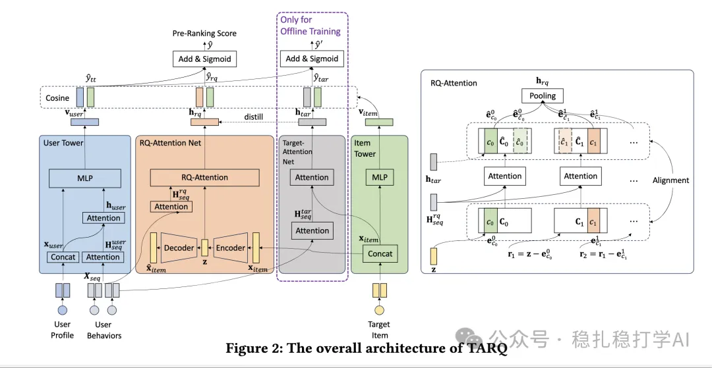

# Recommendation papers (2025.9.23): Alibaba's two-tower pre-ranking, k-means clustering as its own tower

> [中文版](2025-09-23-ali-tarq-preranking.md)

1 Equip Pre-ranking with Target Attention by Residual Quantization

Link: https://arxiv.org/pdf/2509.16931

Company: Alibaba

Idea: quantization (RQ, codebook, k-means, approximation)

Area: pre-ranking

Overview:

In the pre-ranking model, the item's cluster embedding is used as an approximation in modeling the user's interest from the behavior sequence. During training, a student network learns to approximate the classic teacher network for behavior sequence modeling, target attention. At inference, the teacher network is not used; the student network is.

Specifically:

(1) Model structure

A two-tower model: the user tower on the left, the item tower on the right.

(2) Interest modeling

The user tower contains behavior sequence modeling, and it uses target attention. Specifically: each item in the behavior sequence does attention with the target item, giving the interest vector htar.

(3) Student network

1) Overview of the process: the residuals (RQ) used to represent the target item retrieve the most similar representation and its index id from multiple codebooks. The codebook embeddings are updated through an auxiliary task; each row is the embedding of a cluster of target items.

2) The K rows of each codebook serve as Q and do target attention with the behavior sequence, giving K rows of personalized representations. The discrete IDs from 1) pick the corresponding rows, which serve as the interest representation obtained from each codebook. The interest representations from all codebooks are pooled to give this net's final output, and this output is aligned with the interest vector htar from (2) via teacher learning.

(4) Codebook learning

In 1) of (3), when the target item searches each codebook for the nearest cluster embedding, contrastive learning is done over all cluster embeddings: via softmax, it is "pulled closer" to the most similar code and "pushed away" from all the others.

(5) Inference

As in 2) of (3), the K rows of each codebook serve as Q and do target attention with the behavior sequence, giving K rows of personalized representations. This is precomputed. Once the target item's discrete IDs are obtained, the corresponding rows are taken from the M personalized codebooks, and simple pooling then outputs the interest representation.

A/B: in Alibaba advertising, CTR improved over the baseline.

Takeaways: (1) This paper is similar to the one from a few days ago, [Recommendation papers (2025.9.18): Ant Group's two-tower pre-ranking, with k-means clustering helping the user tower](2025-09-18-ant-two-tower-preranking.full.en.md), except that one targets the user tower and this one targets the item tower. (2) Through approximate computation, it achieves both a performance gain and sequence modeling.

Caveats: don't bring in TA as a teacher; bring in the RQ-Attention Net directly as part of the user tower. That approach has been more widely proven. Doing TA with clusters is better optimized for new items; with teacher learning, the effect is not necessarily good.

Credibility: production

Recommendation: practically useful

