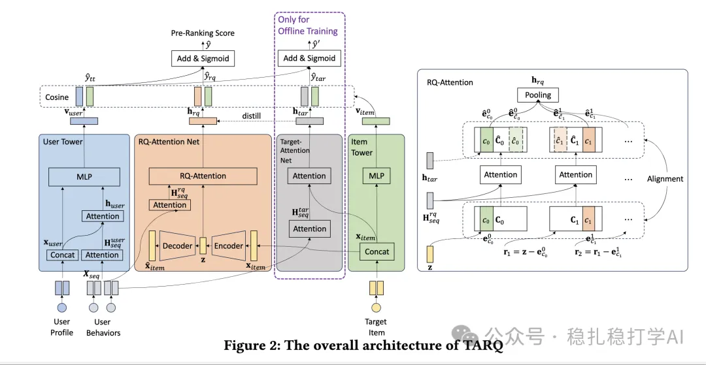

# 推荐算法(2025.9.23)：阿里的双塔粗排，kmeans聚类，独立成塔

> 原文：https://mp.weixin.qq.com/s/1HFAP1SyBpjDfqhLGXakkQ
> 作者：算法工程师刘明星（稳扎稳打学AI）| 发表于 2025-09-23

嘿，记得给“稳扎稳打学AI”添加星标

关注我，每天为你精挑细选最优质、最新鲜的推荐算法paper，陪你一起保持进步、不断精进！

> [English version](2025-09-23-ali-tarq-preranking.full.en.md)

👆 [本公众号paper推荐原则](https://mp.weixin.qq.com/s/BhVGu0qH5kTz9N5zpsD3KA)

1 Equip Pre-ranking with Target Attention by Residual Quantization

网址：https://arxiv.org/pdf/2509.16931

公司：阿里

思想：量化（RQ、codebook、kmeans、近似）

方向：粗排

解读：

在粗排模型里，用物料的cluster embed做近似，参与用户的行为序列的兴趣建模。训练的时候，用一个学生网络，近似学习行为序列建模的经典的教师网络target attention。预估的时候，不用老师网络，而用学生网络。

具体的，

（1）模型结构

双塔模型，左边user塔，右边item塔。

（2）兴趣建模

在user塔里，有一个行为序列的建模。这个行为序列建模，用的就是target attention。具体的：行为序列的每个item，与target item做attention，得到兴趣向量htar。

（3）学生网络

1）过程简述：用来做target item表征的残差（RQ）在多codebook里取出最相似的表征及其索引id。codebook的embed通过一个辅助任务对其更新，每行是target item的cluster的embed。

2）就是每个codebook里的K行作为Q与行为序列做target attention，获得K行的个性化表征。1）中的离散ID获取对应的行，作为每个codebook里获得的兴趣表征。将所有codebook获得的兴趣表征做pooling，作为该net的最终输出，这个输出与（2）的兴趣向量htar做teacher learning，实现对其。

（4）codebook的学习

就是在（3）的1）里，target item从每个codebook里搜寻最近的cluster embed的时候，要对所有cluster embed的对比学习，就是通过softmax，与最相似码本“拉近”，与其余所有项交互“推远”。

（5）推理

如（3）里的2），每个codebook里的K行作为Q与行为序列做target attention，获得K行的个性化表征。这个提前计算好。等获得了target item的离散ID，从相应的M个个性化codebook里取出相应的行，再做简单的pooling，就能输出兴趣表征了。

AB：阿里广告，相比基线，CTR提升。

心得：（1）这篇文章，与前几天的那篇 [推荐算法(2025.9.18)：蚂蚁的双塔粗排，kmeans聚类助力用户塔](https://mp.weixin.qq.com/s/ZbbHYMc-_UCrH8UyKV1LpQ) 类似，不过那篇针对的是user塔，这里针对的item塔。（2）通过近似计算，实现了性能提升和序列建模。

愚见：不引入TA作为teacher，直接引入RQ-Attention Net，并作为user塔的一部分。这样做，更加被普遍证实。用cluster做TA，对新物料更优化，teacher学习，效果不见得好

可信度：生产

推荐等级：有实践价值

请帮忙点赞、转发，谢谢。

## 欢迎干货投稿 \ 论文宣传 \ 合作交流

推荐您继续阅读：

■ [推荐算法(2025.9.22)：阿里的多模态行为序列建模，效果很大](https://mp.weixin.qq.com/s/aXaavKdcurG8DdiCKboscQ)

■ [推荐算法(2025.9.19)：Snap的序列样本的数据增强方法，有实践价值](https://mp.weixin.qq.com/s/gpTJFQA2WLBYsVFDlOw5TA)

历史文章索引：https://docs.qq.com/sheet/DYXZTZ0tseHRyZGtt?tab=BB08J2

请入微信群，群内我会给出更深入的解读，还可以共同讨论技术方案、发招聘广告、内推和交友等。

• 铁粉标准：关注公众号一个月以上，且在公众号上累计10次互动（评论、爱心、转发）、或投稿1次。

• 入群方法：请您加个人微信lmxhappy，我拉您入群，请备注（只我个人看，不公开）。

喜欢的话点个在看吧👇

个人观点，仅供参考
