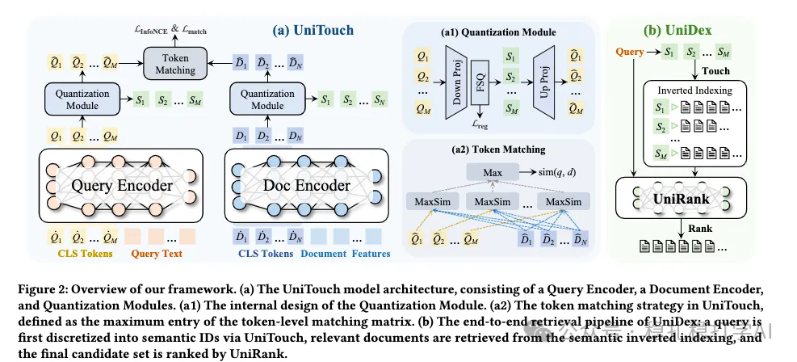

# Daily Pick (2025.10.2): Kuaishou's model-driven inverted index, very effective

> [中文版](2025-10-02-kuaishou-unidex.md)

1 UniDex: Semantic Inverted Indexing with Semantic ID Generation for Efficient Retrieval

Link: https://arxiv.org/pdf/2509.24632

Company: Kuaishou

Idea: inverted index + model-driven (discretization, semantic ID, retrieval)

Area: search retrieval

Overview: In the search setting, a two-tower model maps the query and the document to their respective representations, and these are discretized into discrete vectors (every dimension is a small integer). The document can then be put into an inverted index offline according to its discrete vector. At retrieval time, the query's discrete vector is generated in real time, and documents are retrieved through the inverted index.

(1) Encoder

The query and the document work the same way: both use a BERT model. At input time, besides the query (document) text, several learnable tokens (really just learnable vectors) are inserted. The BERT outputs at those token positions are taken as multiple representations of the query (document).

(2) Quantization

Each representation from (1) is quantized (i.e., turned from a continuous vector into a discrete one), and each representation gets one quantized ID. In the end, the query (document) corresponds to a vector made of multiple quantized IDs.

(3) Matching

The query's quantized IDs and the document's quantized IDs are matched with max: each quantized ID of the query computes similarity against all quantized IDs of the document, and the maximum is taken as that query ID's score. Finally, the scores of all the query's quantized IDs are summed to give the query-document matching score.

(4) Retrieval

Offline: the document's quantized IDs are used as keys of the inverted index, with the document as the value, to build the inverted index.

Online: the query generates its quantized IDs in real time, and documents are retrieved through the inverted index.

A/B: Deployed in Kuaishou short-video search: the relevant-result scarcity rate (RRS) dropped by 25%, click-through rate (CTR) rose 17.67%, and system response time improved by 25%.

Takeaways: (1) Discretization can improve generalization, and it can also improve efficiency.

Credibility: production

Recommendation: has practical value

