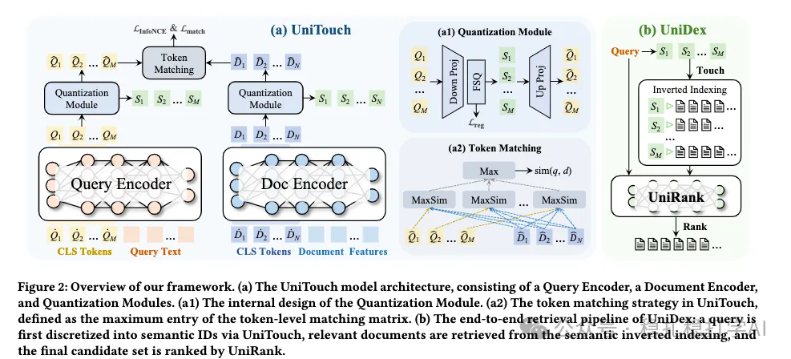

# 推荐算法(2025.10.2)：快手的模型驱动的倒排索引，很有效

> 原文：https://mp.weixin.qq.com/s/IpNlevDyRk-KJs-Q1AmJFw
> 作者：算法工程师刘明星（稳扎稳打学AI）| 发表于 2025-10-02（修改于2025年10月2日）

嘿，记得给“稳扎稳打学AI”添加星标

关注我，每天为你精挑细选最优质、最新鲜的推荐算法paper，陪你一起保持进步、不断精进！

> [English version](2025-10-02-kuaishou-unidex.full.en.md)

👆 [本公众号paper推荐原则](https://mp.weixin.qq.com/s/BhVGu0qH5kTz9N5zpsD3KA)

1 UniDex: Semantic Inverted Indexing with Semantic ID Generation for Efficient Retrieval

网址：https://arxiv.org/pdf/2509.24632

公司：快手

思想：倒排索引+模型驱动（离散化、语义ID、召回）

方向：搜索召回

解读：搜索场景下，对query和document通过双塔模型，分别映射获得的表征，通过离散化获得各自的离散化向量（各个维度都是较小的整数）。这样，document根据离散化向量，可以离线做好倒排索引。召回的时候，query实时生成离散化向量，从而可以通过倒排索引召回document。

（1）encoder

query和document的原理相同，都是bert模型。输入的时候，除了query（document）的文本，插入多个可学习的token（其实就是可学习向量），经过bert获得了这些token的对应输出，作为query（document）的多个表征。

（2）量化

对（1）中的每个表征，都做量化（即连续向量到离散向量），每个表征对应一个量化ID。最终，query（document）对应多个量化ID组成的向量。

（3）匹配

query的多个量化ID，与document的多个量化ID，做max匹配，即query的每个量化ID，与document的所有量化ID，计算相似度，取最大值，作为该query量化ID的得分；最终，query的所有量化ID的得分，做求和，作为query与document的匹配得分。

（4）召回

离线：document的多个量化ID，作为倒排索引的key，document作为value，构建倒排索引。

在线：query实时生成多个量化ID，通过倒排索引，召回document。

AB：在快手短视频搜索部署，提升相关结果稀缺率（RRS）下降25%、点击率（CTR）提升17.67%，统响应时间改善25%。

心得：（1）离散化可以提高泛化能力，也可以提高效率。

可信度：生产

推荐等级：有实践价值

请帮忙点赞、转发，谢谢。

## 欢迎干货投稿 \ 论文宣传 \ 合作交流

推荐您继续阅读：

■ [推荐算法(2025.10.1)：阿里的模型打标签方法，效果很不错](https://mp.weixin.qq.com/s/csPTTnmGkTxiZ59fEziikg)

■ [推荐算法(2025.9.29)：阿里的子任务的知识迁移方法](https://mp.weixin.qq.com/s/rD39A0g6Y5bewV1ahWLMvA)

历史文章索引：https://docs.qq.com/sheet/DYXZTZ0tseHRyZGtt?tab=BB08J2

请入微信群，群内我会给出更深入的解读，还可以共同讨论技术方案、发招聘广告、内推和交友等。

• 铁粉标准：关注公众号一个月以上，且在公众号上累计15次互动（评论、爱心、转发）、或投稿1次。

• 入群方法：请您加个人微信lmxhappy，我拉您入群，请备注（只我个人看，不公开）。

喜欢的话点个在看吧👇

个人观点，仅供参考

修改于2025年10月2日
