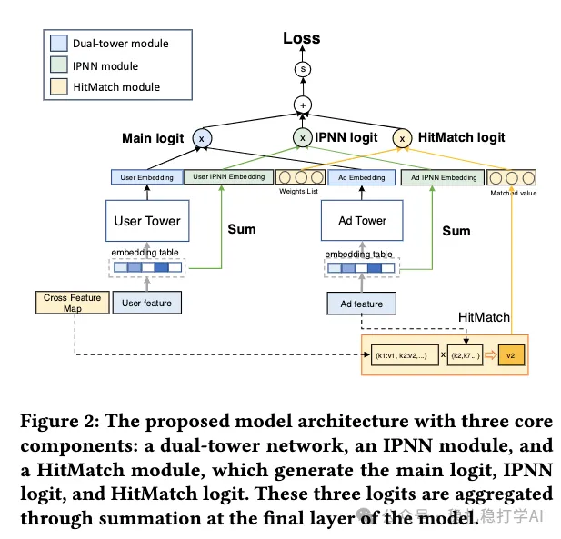

# Daily Pick (2025.12.2): Tencent, ad retrieval, explicit matching features, GMV +1.58%

> [中文版](2025-12-02-tencent-ad-retrieval-hitmatch.md)

1 An Efficient Embedding Based Ad Retrieval with GPU-Powered Feature Interaction

Link: https://arxiv.org/pdf/2511.22460

Company: Tencent

Idea: more feature crossing, especially explicit crossing

Area: retrieval + EBR (embedding-based retrieval) + explicit matching

Overview:

In the two-tower model used for ad retrieval, this paper introduces two kinds of feature interaction: explicit feature interaction and implicit feature interaction. It also optimizes the GPU computation of the explicit feature interaction so that it can actually be deployed.

The two-tower structure is the same as the usual one, a user tower plus an ad tower; the difference is that the user tower adds two modules after the embedding layer: explicit feature interaction and implicit feature interaction. Why? Because in a two-tower model, the user tower and the ad tower have no interaction other than the final score (the inner product). Adding the explicit and implicit feature interactions is meant to bring ad-side information into the user tower, so that the user tower and the ad tower interact.

Explicit feature interaction: use the item's features to look them up in the user feature map; if there is a match it is a hit, and it is multiplied by the corresponding weight. Every hit feature value is computed this way and all are summed, giving this module's output. The number of feature values is very large, and if the computation takes too long it cannot be used in the retrieval stage. The paper designs a corresponding GPU-optimized algorithm to speed it up.

Implicit feature interaction: use the item tower's feature vector as the query and the user-side features as key/value, do cross-attention, and get this module's output.

During training, each of the two modules is a separate score optimized together with the main towers. At inference, the outputs of both modules serve as supplementary scores (logits) to the two-tower model, summed with the two-tower score to give the final score.

A/B: On WeChat Moments and Channels, offline GAUC +2.62%, GMV +1.58%.

Takeaways:

(1) The paper says the explicit feature interaction is a wide network; the implicit feature interaction is then just one dense layer, so it sits halfway between dense and wide.

(2) The implicit feature interaction is a freebie thrown in while the paper "sells" the explicit feature interaction. You can tell from the paper's title and from how the contributions are described. If the main towers are the deep part and the explicit feature interaction is the wide part, then adding a simplified deep tower in between is something you'd do in passing.

Credibility: production

Recommendation: has practical value

