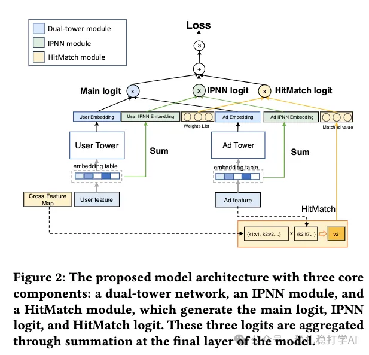

# 推荐算法(2025.12.2)：腾讯，广告召回，显性匹配特征，GMV +1.58%

> 原文：https://mp.weixin.qq.com/s/tM8u8yvffWN2PW3Pde1ppA
> 作者：算法工程师刘明星（稳扎稳打学AI）| 发表于 2025-12-02（标题已修改；修改于2025年12月2日）

嘿，记得给“稳扎稳打学AI”添加星标

关注我，每天为你精挑细选最优质、最新鲜的推荐算法paper，陪你一起保持进步、不断精进！

👆 [本公众号paper推荐原则](https://mp.weixin.qq.com/s/BhVGu0qH5kTz9N5zpsD3KA)

1 An Efficient Embedding Based Ad Retrieval with GPU-Powered Feature Interaction

网址：https://arxiv.org/pdf/2511.22460

公司：腾讯

思想：更多交叉，特别是显性交叉

方向：召回+ebr+显性匹配

解读：

本文在做广告召回的双塔模型里，引入了2种特征交叉，显性特征交叉和隐性特征交叉。并且优化了显性特征交叉的GPU计算，从而实现。

双塔模型结构和普通的结构一样，都是用户塔+广告塔；区别就是，用户塔在embedding层后，增加了2个模块：显性特征交叉和隐性特征交叉。为什么？因为双塔模型在用户塔和广告塔之间，除了最后的打分（内积）外，没有其它的交互。引入显性特征交叉和隐性特征交叉，就是想在用户塔里，加入广告侧的信息，从而实现用户塔和广告塔的交互。

显性特征交叉：用item的特征去用户特征map里去匹配，如果匹配就命中，就乘以对应的weight。所有命中的特征值，都如此计算，并全部加和。作为该模块的输出。特征值的数量特别多，计算耗时太长就无法应用到召回环节。本文设计了相应的GPU优化算法做加速。

隐性特征交叉：用item塔的特征向量作为query，用户侧的特征作为key/value，做cross-attention，得到该模块的输出。

训练的时候，这2个模块都是作为单独的分数，与主塔一起优化，推理的时候，2个模块的输出都作为双塔模型的补充分数（logit），与双塔模型的分数一起加和，作为最终的分数。

AB：WeChat Moments 和 Channel 上，离线 GAUC 提高 2.62%，GMV 提高 1.58%。

心得：

（1）本文说显性特征交叉是wide网络，那么隐性特征交叉就一层dense，那就是dense和wide的中间状态。

（2）隐性特征交叉是本文“兜售”显性特征交叉的时候，不要钱送的。从论文的题目和贡献等处的论述就能看出来。如果说主塔是deep，显性特征交叉是wide，那么再用一个中间的简化的deep塔，就是顺带手的事

可信度：生产

推荐等级：有实践价值

请帮忙点赞、转发，谢谢。

## 欢迎干货投稿 \ 论文宣传 \ 合作交流

推荐您继续阅读：

■ [推荐算法(2025.11.28)：美团，物料去重，小工作，大效果](https://mp.weixin.qq.com/s/5wHgtKr3wLDI-VtVYtjZLQ)

■ [推荐算法(2025.11.21)：快手，ebr召回，正样本找的真全](https://mp.weixin.qq.com/s/MPWLKFU6d2iYm9TuWPem6g)

历史文章索引：https://docs.qq.com/sheet/DYXZTZ0tseHRyZGtt?tab=BB08J2

请入微信群，群内我会给出更深入的解读，还可以共同讨论技术方案、发招聘广告、内推和交友等。

• 铁粉标准：关注公众号一个月以上，且在公众号上累计15次互动（评论、爱心、转发）、或投稿1次，只欢迎技术同学。

• 入群方法：请您加个人微信lmxhappy，我拉您入群，请备注（只我个人看，不公开）。

喜欢的话点个在看吧👇

个人观点，仅供参考

修改于2025年12月2日
