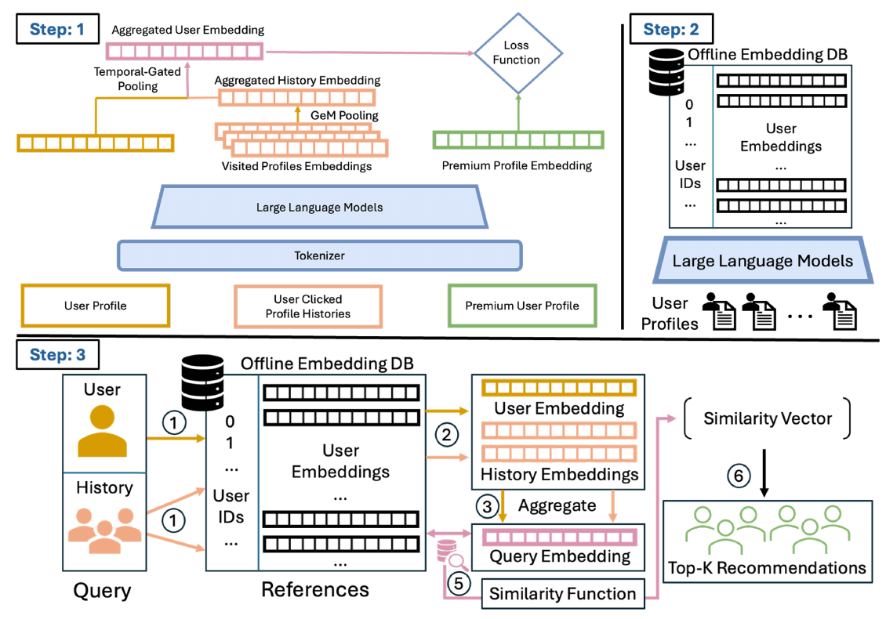

---

LinkedIn's PAIR: CTR +7.5% and Premium retention +2.1% for people recommendation, with a refreshingly simple recipe.

It's a two-tower retriever with a 0.6B LLM encoder, a weighted average over the user's last 10 clicks, and exposed-but-unclicked plus random negatives. Proven building blocks, put together cleanly.

What I find most useful is where the gain comes from: the baseline was LinkedIn's platform-wide member embedding, shared across many products. Fine-tuning on this surface's own clicks did most of the work. A good reminder that a model tuned for the surface usually beats a general-purpose one.

One question I'd love to see answered: the paper frames professional relevance as "complementary" (job seekers want recruiters, not peers). The model learns from clicks rather than targeting that directly, so it would be great to see how often the retrieved people are actually cross-role.

Full breakdown:
https://github.com/lmxhappy/step-by-step-learning-ai/blob/main/deep-retrieval/linkedin-pair.full.en.md

#RecommenderSystems #LinkedIn #MachineLearning #InformationRetrieval #AI
