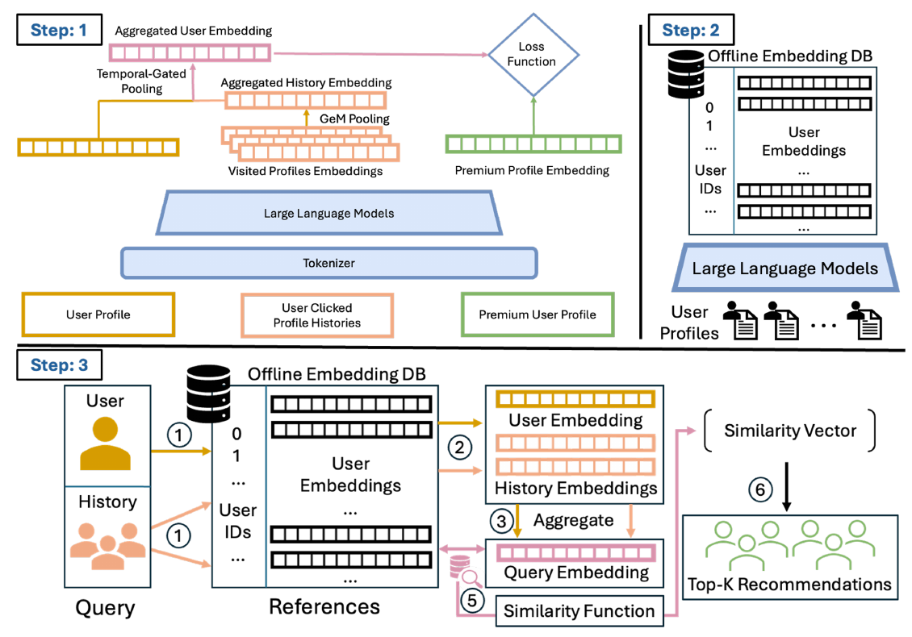

# LinkedIn一个小场景的向量召回

关注我，每天为你精挑细选最优质、最新鲜的推荐算法paper，陪你一起保持进步、不断精进！

> [English version](linkedin-pair.en.md)

### 论文：PAIR: Preference-Aligned Intent Retrieval for Premium People Recommendation at LinkedIn
### 网址：https://arxiv.org/abs/2610.30941
### 公司：LinkedIn
### 思想：场景定制带来增益
### 方向：向量召回、LLM embedding

## 解读：
这篇没有新技术，本文就是用大家常用的向量召回，给LinkedIn VIP会员推荐其他好友。模型是双塔加历史加权平均，负样本是曝光未点击加随机。
原来：线上用 LinkedIn 平台通用的会员向量，它是很多产品的互动目标上联合训练而获得的，从没用在该场景里，定制训练过；现在：用这个场景的点击数据去微调LLM的画像塔。
另外，此场景下，之前的推荐逻辑是「相似」，用点击偏好代替简历相似。

### 1. 模型（三塔）

**用户画像塔**：把用户的个人主页上的简历（标题、简介、经历、教育、技能等）拼成文本，过一个 0.6B 的 LLM 向量模型，得到 1024 维向量，作为用户画像向量。

**候选塔**：用户的个人主页和候选的个人主页，都是个人主页。候选共用上面用户塔的编码器，训练时一起微调，上线后每天离线批量算。获得**候选向量**。

**用户塔**：取用户最近点击的 10 个人组成的行为序列，生成画像向量，叫意图向量。给每个人打一个分 = w·(该人的画像向量 + 位置编码)，10 个分做 softmax 得到权重，再对 10 个画像向量加权平均。w 和位置编码都是可学的，最近一次点击排第 1 位。权重不看用户本人，所以用户有新点击时，CPU 上重新加权一次就行，不用重跑 LLM。

**用户向量** = norm(用户画像向量 + γ × 意图向量)，两个向量先各自归一化，γ 可学。

用户向量和候选向量算余弦相似度召回。另外用了"套娃"训练（Matryoshka）：损失不只在完整的 1024 维上算，还在前 200、256、512 维上各算一遍再相加，逼向量的前几段自己就能用。这样线上可以只取前 256 维，省存储、省检索时间，不用另训一个小模型。这个场景用全部 1024 维。

### 2. 训练——负样本和损失函数

每次曝光会话里，被点击的候选是正样本。每个正样本配 3 个负样本：优先用同一会话里**曝光了但没点**的人，不够 3 个再从活跃 Premium 会员里随机补。

损失就是常规的多负样本对比损失：用户向量和候选向量算余弦相似度（温度 0.02），让正样本得分高于 3 个负样本。

### A/B：
对照组是线上的通用会员向量。CTR +7.5%，Premium 留存率 +2.1%。

## 心得：
* 定制化的东西比通用的，效果更好，在机器学习上，这几乎是铁定的。
* 在实打实充钱的会员服务场景，还是要多做一些工作的。
* linkedin的人手看样子也不是特别充足。

## 愚见
* 真正的增量是"在职场人脉这个场景里，用点击偏好代替简历相似"这个问题定义，以及把它落地。
* 论文通篇讲职场关系是"互补"的：求职的工程师要找招聘者，不是另一个工程师。但模型里没有任何针对互补的设计，只是学"用户会点谁"。推出来的到底是不是互补的人，论文没有证据。我看未必。
* 从产品形态看，这很像 I2I：模块挂在某个人的主页上，推荐其他人，经典做法就是"看过这个人的也看过谁"，按共现或相似找。但本文的查询方不是正在被看的那个主页，而是**看主页的这个用户**：用他的画像和最近点击过的人去召回。所以模型上它其实是 U2I（用户找人）。其实可以尝试将用户正在看的用户加入进去，作为i2i推荐。

## 可信度：生产

## 推荐等级：有时间看看

**请帮忙点赞、转发，谢谢。欢迎干货投稿 \ 论文宣传\ 合作交流**

### 【铁粉】请入微信群，群内我会给出更深入的解读，还可以共同讨论技术方案、发招聘广告、内推和交友等。
* 铁粉标准：关注公众号一个月以上，且在公众号上累计15次互动（评论、爱心、转发）、或投稿1次，只欢迎技术同学。
* 入群方法：请您加个人微信lmxhappy，我拉您入群，请备注【公司】（只我个人看，不公开）。

## 推荐您继续阅读：
