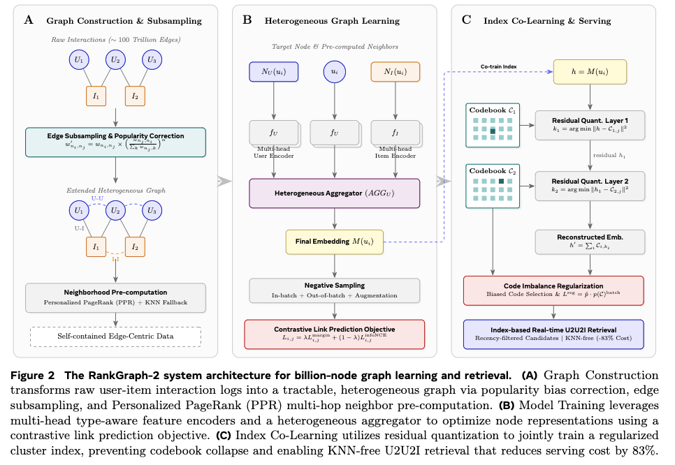

# Meta: clustering for graph retrieval, lower cost and better results

> [中文版](meta-rankgraph.md)

### Paper: RankGraph-2: Lifecycle Co-Design for Billion-Node Graph Learning in Recommendation
### Link: https://arxiv.org/html/2606.18379
### Company: Meta
### Idea: clustering, end-to-end
### Area: graph learning + retrieval + semantic SID

## Overview:
In graph construction, this paper greatly simplifies the graph structure and precomputes neighbors; in training, it uses a lightweight heterogeneous GNN and jointly learns the serving index, quantizing user representations into Cluster IDs. This achieves low-cost, high-quality U2U2I retrieval while keeping the performance of U2I2I.

### 1 Graph construction
#### (1) Initial graph creation
The graph has only two node types (users, items) and three edge types (U-I, U-U, I-I), all from engagement data (clicks, likes, shares, purchases); no external social graph or knowledge graph is used.
* U-I edges (directed): an edge is created if there was an interaction in the past $T$ hours, with weights predefined by business value.
* U-U edges (undirected co-engagement edges): based on the set of items the two users both interacted with in the past T hours. An edge is created only if the number of co-engaged items is $\geq C_U$. Take the product of the two users' weights on each such item and sum these products. The log is taken so that edge weights of high-frequency and low-frequency users are on the same scale.
* I-I edges (undirected co-engaged-by edges): similar to U-U edges. Based on the set of users who engaged with both items in the past T hours. An edge is created only if the number of co-engaging users is $\geq C_I$. Take the product of one user's weights on the two items and sum these products. The log is taken so that edge weights of high-frequency and low-frequency users are on the same scale.

#### (2) Popularity bias correction
In I-I edges, if an item node is a popular item, the summation makes the weights of I-I edges from it too large. Popular items then push every node's embedding too far toward popular items. The fix is to normalize this weight.

The correction is only applied to I-I edges. Why only I-I? Because the popularity bias of U-U edges is relatively mild, while I-I edges have the biggest impact on long-tail item coverage.

#### (3) Aggressive sampling: keep high-value nodes + top-K edges per node, compressing the edge count by three orders of magnitude.
Step 1, node filtering: first filter user nodes, keeping only the roughly 100 million users with the highest business value (~0.1B nodes). U-U edges are only built among these selected users. Other lower-value users do not take part in building U-U edges (but they remain in U-I edges). This "high business value user list" is refreshed daily (adjusted dynamically by business metrics).

Step 2, edge pruning: among the 100 million high-value users selected above (and other nodes), each node keeps only its K_CAP highest-weight edges.
This is a local top-K per node, not a global ranking of all edges.

After this edge subsampling (especially U-U edges kept only for ~0.1B high-value users), a large number of ordinary users have no U-U edges at all (i.e., no same-type neighbors). Likewise, some items may lose all their same-type neighbors after I-I edge subsampling. So nodes split into two groups:
* Group 1: nodes with same-type neighbors.
* Group 2: nodes without same-type neighbors.

The graph after sampling is called the extended graph. The graph formed by Group 1 is called the backbone graph.

### 2 Training sample preparation
Training samples are obtained from the constructed graph in two steps:
#### (1) Neighbor precomputation
Inspired by PinSage, Personalized PageRank (PPR) is used on the backbone graph to precompute, for each node, the $K= 50$ most important same-type neighbors + different-type neighbors. Concretely: from each node, run R random walks of length L. At each step there is a restart probability = 0.15 of returning to the start node (this is where "Personalized" comes from). The visit frequency of each node is counted as its importance score.

#### (2) Output data format
Each record of the data contains an edge $(n_i, n_j, w)$, the features of both endpoints, and the precomputed neighbor lists, stored partitioned by edge type. This lets training read sequentially, with no online graph queries.
This is the last step of graph construction, and a very important engineering piece of the whole Lifecycle Co-Design. Its core goal: package the results of all the complex processing above (subsampling, popularity correction, PPR neighbor precomputation, Group 1/Group 2 handling) into a "self-contained" data format, so the training stage needs no online graph infrastructure at all. Self-contained means each record already includes all the information training needs (edge + features + neighbors).

### 3 Training
Graph learning for link prediction and discretizing the User node representations into semantic SIDs are learned end to end. Note that both items and users take part in the former, but only user nodes take part in the latter.
The purpose of quantization is that U2U no longer needs ANN search over user embeddings: just compute the SID of every user's embedding offline, and then conversely the user set of each SID is fixed, which makes the later retrieval convenient.

#### (1) Main task: graph learning for link prediction
Each User node has a fixed K user neighbors + K item neighbors. In training, what is actually used is 10 neighbors randomly sampled from the 50 precomputed ones. This fixed-size design greatly simplifies the training pipeline.
Each node's representation has 3 parts: the node itself, K user neighbors and K item neighbors. Each part goes through its own encoder, and an aggregator combines them into one representation.
Contrastive learning for link prediction is done with negatives of several difficulty levels. This prediction task learns the node representations on the graph.

Loss functions such as Margin Ranking Loss and InfoNCE are used. Design rationale: margin loss is more robust to hard negatives, InfoNCE gives a better global contrastive signal, and the combination is stable in industrial large-scale training.

#### (2) Quantizing into SIDs
A node's representation embedding is discretized into a two-level SID through a residual quantization index. The usual reconstruction loss of quantization plus two regularization-related losses ensure high-quality SIDs.

**Auxiliary task 1: reconstruction**
With the two-level codebook, the sum of the embeddings of the chosen codes is the prediction, the original embedding is the supervision signal, and L2 distance is the reconstruction loss.

**Auxiliary task 2: regularization 1**
The inner product between the current batch's codebook code usage probability distribution and the historical average code usage probability over the past 1000 batches is used as a loss, trained together with the main loss. The former is computed with a custom softmax probability.

Why? The real purpose of this regularization is not to make the current distribution close to the historical one, but to actively break the skew (collapse) that history has formed, making the current distribution behave differently, so that some codes don't end up entirely unused and the codebook stays healthy during long training.
Concretely, during continuous training some codes may already be overused (high probability) while others are ignored for a long time (close to 0). Minimizing the inner product of these two distributions makes the current batch use fewer of the historically heavily used codes and, relatively, more of the historically less used ones. This is actually an active debiasing and exploration mechanism.

**Auxiliary task 3: regularization 2**
Change how a code is chosen from the codebook during quantization. Normally the code with the smallest L2 distance is chosen; instead, choose the one with the largest ratio of the two probabilities from "regularization 1".
This way, if a code has rarely been used historically, even if it is not the nearest, as long as the current embedding is reasonably close to it, it is more likely to be chosen. It works like a load-balancing mechanism, actively routing traffic to less-used codes.

### Serving
* U2U2I retrieval: the pipeline above gives the user representation and its semantic SID, which assigns the user to a Cluster. Each Cluster maintains a queue of items interacted with by recently active users in that Cluster (e.g., the past 15 minutes). At serving time, read the queue of the target user's Cluster.
* U2I2I retrieval: get the items the user has interacted with, taking seed items from the user's recent behavior. Use item embeddings with an ANN index to quickly find other items similar to the seed items. The similar results of multiple items are fused (weighting, deduplication, shuffling for diversity, etc.) to produce the U2I2I candidate set.

### A/B:
* U2I2I: up to +0.96% CTR, +2.75% CVR
* U2U2I: +0.40% CTR, +1.01% CVR
* Serving cost reduced by 83%

## Takeaways:
* Methods like recency windows, sampling and top-K simplify the graph; using only one GNN layer simplifies graph learning; using only a two-level codebook simplifies semantic SID learning, with a lot of effort spent on improving code quality. This saves the cost of expensive online graph infrastructure (graph storage + distributed sampling).

## Caveats
* In Figure 2B, u_i being processed by f_U should be changed to f_t.

## Credibility: production

## Recommendation: has practical value

