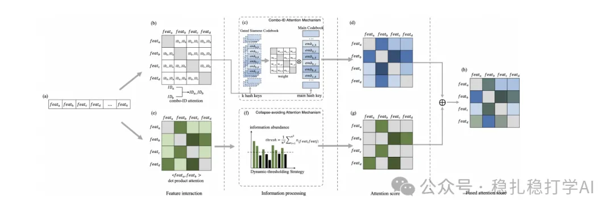

# Daily Pick (2025.3.17): Alibaba's improvement to Transformer-based feature crossing

> [中文版](2025-03-17-ali-feature-interaction.md)

1 Addressing Information Loss and Interaction Collapse: A Dual Enhanced Attention Framework for Feature Interaction

Link: https://arxiv.org/pdf/2503.11233

Company: Alibaba

Area: feature crossing

Overview:

Transformer methods are very popular in recommendation, and their self-attention can naturally serve as a way of doing feature crossing. But used directly, it has two problems: first, information loss, i.e., feature information gets compressed away; second, interaction collapse, i.e., during feature crossing the attention of high-frequency features becomes highly similar.

Concretely, two methods:

(1) Attention over two-ID combinations: for some feature combinations, a strong crossing effect often appears when the two features occur together. Attention over single features alone tends to miss this effect. So when modeling feature crossing, the model treats these key feature combinations specially, making it more sensitive to feature interactions.

First, an MLP computes the attention weight of a two-ID combination. Its inputs are the embeddings of the two feature IDs and their ID combination, so that the combination's attention score is determined by its embeddings. Second, in feature interaction modeling, the two-ID combination's attention score is used as a new feature, serving as the interaction weight. The model can then better handle feature combinations that need strong interaction, and better capture complex interactions between features.

(2) Collapse-avoiding attention: when modeling feature interaction, adjust how attention is computed to reduce the model's reliance on high-frequency features and keep them from dominating the attention scores. This matters a lot, because when high-frequency features dominate, the model's attention distribution becomes concentrated and low-frequency features get ignored. The model introduces an information-based weight adjustment mechanism that spreads the attention scores more evenly across features, preventing interaction collapse. Specifically, the model first computes each feature's attention score and weights these scores by feature occurrence frequency. Attention scores of low-frequency features get boosted to some degree, avoiding a monopoly by high-frequency features. Finally, the attention scores are normalized with a softmax.

Credibility: offline

Recommendation: recommended reading

