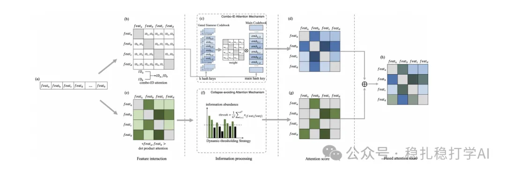

# 推荐算法(2025.3.17)：阿里的Transformer特征交叉方法改进

> 原文：https://mp.weixin.qq.com/s?__biz=MzkzNDYyNjM1NA==&mid=2247484331&idx=1&sn=0275ea88d3ae2df4b4c46a37c390ba01&scene=21#wechat_redirect
> 作者：算法工程师刘明星（稳扎稳打学AI）| 发表于 2025-03-17

嘿，记得给“稳扎稳打学AI”添加星标

关注我，每天为你精挑细选最优质、最新鲜的推荐算法paper，陪你一起保持进步、不断精进！

📄 [本公众号paper推荐原则](https://mp.weixin.qq.com/s?__biz=MzkzNDYyNjM1NA==&mid=2247484097&idx=1&sn=18322c279290b555eb030e12953b7c7f&scene=21#wechat_redirect)

1 Addressing Information Loss and Interaction Collapse: A Dual Enhanced Attention Framework for Feature Interaction

网址：https://arxiv.org/pdf/2503.11233

公司：阿里

方向：特征交叉

解读：

Transformer方法在推荐中很火，其中的self-attention天然可以作为特征交叉的一种方法，但如果直接用，就会有两个问题：一是信息的损失，即特征信息会被压缩掉；二是交互崩溃，即特征交叉时高频特征的注意力会变得高度相似。

具体的，两个方法：

（1）两个ID组合的注意力机制：对于一些特征组合，两个特征共同出现时，往往会产生强烈的交叉效应。如果只用单个特征的注意力，往往会忽略这种效应。因此，模型在对特征交叉进行建模时，对这些关键的特征组合进行特殊处理，增强了模型对特征交互的敏感性。

首先，使用一个MLP计算两个ID组合的注意力权重。这种方式的输入特征为两个特征ID的embedding，以及它们的ID组合，这样的建模方式，使得组合的注意力分数由其embedding决定。其次，在特征交互建模中，将两个ID组合的注意力分数作为新的特征，用作交互的权重，模型能够更好地处理那些需要强烈交互的特征组合，从而更好地捕捉到特征之间复杂的相互作用。

（2）避免崩溃注意力机制：即在对特征交互进行建模时，通过调整注意力的计算方式，减少模型对高频特征的依赖，避免高频特征主导注意力得分。这一点特别重要，因为当高频特征主导时，模型的注意力分布变得集中，导致模型对低频特征的忽略。模型通过引入一个基于信息量的权重调整机制，将注意力得分的分布更加均匀地分散到不同的特征上，从而防止了交互崩溃的现象。具体来说，模型首先计算每个特征的注意力得分，并根据特征的出现频率对这些得分进行加权。低频特征的注意力得分会得到一定程度的提升，避免了高频特征的垄断。最后，注意力得分的计算是通过softmax操作来归一化的。

可信度：离线

推荐等级：推荐看看

请帮忙点赞、转发，谢谢。您认为哪篇论文最有潜力应用到实际业务中？

## 欢迎干货投稿 \ 论文宣传 \ 合作交流

推荐您继续阅读：

■ [推荐算法周报(2025.3.14)：解藕与LLM是提升推荐效果的好方法](https://mp.weixin.qq.com/s?__biz=MzkzNDYyNjM1NA==&mid=2247484325&idx=1&sn=28ebac92b626e4681e9d43c1b51e99a2&scene=21#wechat_redirect)

■ [推荐算法周报(2025.3.8)：行为序列与大模型领衔，亮点纷呈](https://mp.weixin.qq.com/s?__biz=MzkzNDYyNjM1NA==&mid=2247484301&idx=1&sn=ed438d08ec7160e42fffec7c27891f62&scene=21#wechat_redirect)

■ [推荐算法(2025.3.11)：去偏专业户快手的又一力作](https://mp.weixin.qq.com/s?__biz=MzkzNDYyNjM1NA==&mid=2247484316&idx=1&sn=76c0bbf3c3310a6366d7cd0ca13c6d83&scene=21#wechat_redirect)

历史文章索引：https://docs.qq.com/sheet/DYXZTZ0tseHRyZGtt?tab=BB08J2

由于公众号试行乱序推送，您可能不再准时收到稳扎稳打学AI的推送。为了第一时间收到本号的干货内容， 请将本号设为星标，以及常点文末右下角的“在看”。

喜欢的话点个在看吧👇

个人观点，仅供参考
