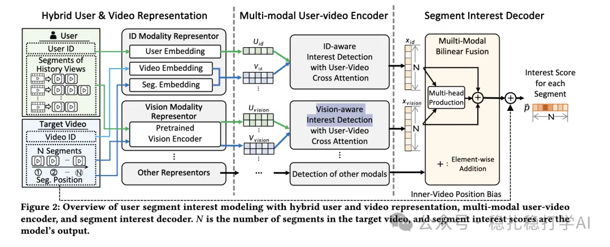

# Recommendation papers (2025.4.8): Meta uses segment information to improve sponsored search CTR prediction
> [中文版](2025-04-08-meta-segment-ctr.md)

> Source: WeChat post https://mp.weixin.qq.com/s?__biz=MzkzNDYyNjM1NA==&mid=2247484424&idx=1&sn=103d2fab460bb03ccfd332c5f1c2f0a3&scene=21#wechat_redirect, published 2025-04-08.
> Split from the roundup "Recommendation papers (2025.4.8): the devil is in the details"; same issue: [Meta segment-information CTR prediction](../feature-cross/2025-04-08-meta-segment-ctr.full.en.md), [Alibaba Masked Softmax Loss](../generative-recommendation/2025-04-08-ali-masked-softmax-loss.full.en.md), [Alibaba re-ranking consistency principles](../multi-task-learning/2025-04-08-ali-rerank-consistency.full.en.md).

Intro of this issue:

(1) All 3 papers in this issue are worth reading. The techniques they use may not be very new, but the devil is in the details.

(2) The highlight of the first paper is how it handles "high-dimensional sparse + low-dimensional dense" features, which clearly improves CTR prediction.

**The devil is in the details: something worth reminding ourselves of again and again at work!**

Improving CTR Prediction in Sponsored Search Using Segment Information

Link: https://arxiv.org/pdf/2504.02799

Company: Meta

Area: CTR prediction

Overview:

Instead of pooling the segment interest scores directly, the paper uses the base recommendation model to compute the final score?

Segment information carries rich user interest: the segments a user likes are used as features. Each segment may represent a specific interest category, e.g. liking food, travel, sports, etc. The CTR prediction model uses this segment information to strengthen its predictions.

How it stays efficient and scalable: the paper uses segment embeddings, turning segment interest information into vectors, and the model aggregates the segment embeddings to produce the final user representation.

Takeaways:

(1) For CTR prediction models, feature processing is everything. In this paper, how are high-dimensional sparse features and low-dimensional dense features handled?

(2) For CTR prediction in recommender systems, the ranking of feature value: context/scenario, position, behavior, features.

Credibility: offline

Recommendation: worth reading

