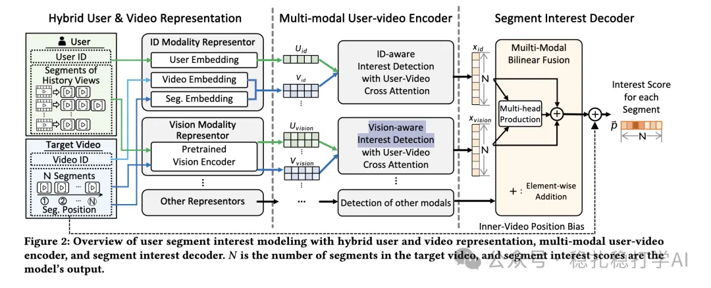

# 推荐算法(2025.4.8)：Meta用片段信息提升搜索广告CTR预估

> 原文：https://mp.weixin.qq.com/s?__biz=MzkzNDYyNjM1NA==&mid=2247484424&idx=1&sn=103d2fab460bb03ccfd332c5f1c2f0a3&scene=21#wechat_redirect
> 作者：算法工程师刘明星（稳扎稳打学AI）| 发表于 2025-04-08
> 本文拆自《推荐算法(2025.4.8)：魔鬼藏在细节里》，同期 3 篇：[Meta 片段信息 CTR 预估](../feature-cross/2025-04-08-meta-segment-ctr.md)、[阿里 Masked Softmax Loss](../generative-recommendation/2025-04-08-ali-masked-softmax-loss.md)、[阿里重排一致性原则](../multi-task-learning/2025-04-08-ali-rerank-consistency.md)。

关注我，每天为你精挑细选最优质、最新鲜的推荐算法paper，陪你一起保持进步、不断精进！

> [English version](2025-04-08-meta-segment-ctr.full.en.md)

当期前言：

（1）这篇的3篇paper都值得看，虽然paper中用到的技术可能不是很新颖，但是在魔鬼藏在细节里。

（2）第一篇的亮点在于对“高维稀疏+低维稠密”的特征处理，对CTR预估效果提升明显。

**魔鬼藏在细节里，这句话值得我们在工作中不断提醒自己！**

Improving CTR Prediction in Sponsored Search Using Segment Information

网址：https://arxiv.org/pdf/2504.02799

公司：Meta

方向：CTR预估

解读：

论文不直接对片段兴趣得分进行池化，而是借助基础推荐模型计算最终得分？

片段信息包含丰富的用户兴趣：以用户喜欢的片段为特征。每个片段可能代表一个特定的兴趣类别，例如，喜欢美食、旅游、运动等。CTR 预测模型利用这些片段信息来增强预测能力。

如何做到高效和可扩展：论文使用了片段嵌入（segment embeddings），将片段的兴趣信息转化为向量，模型通过聚合片段的嵌入来生成最终的用户表示。

心得：

（1）对点击率预估模型来说，特征处理就是一切。本篇中，如何处理高维稀疏特征和低维稠密特征？

（2）推荐系统中的CTR预估，特征的价值排序：场景、位置、行为、特征。

可信度：离线

推荐等级：推荐看看

