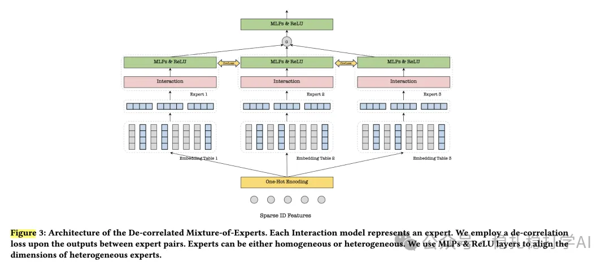

# Recommendation papers (2025.6.1): Tencent D-MoE, de-correlated expert networks for CTR prediction
> [中文版](2025-06-05-tencent-d-moe.md)

> Source: WeChat post https://mp.weixin.qq.com/s/_esAw4QjZiVvbK8bKdJXmQ, published 2025-06-05.
> Split from the weekly report "Weekly recommendation papers (2025.6.1): a week of blockbuster A/B results", paper 4 of the issue.

Enhancing CTR Prediction with De-correlated Expert Networks

Link: https://arxiv.org/pdf/2505.17925

Company: Tencent

Area: network optimization

Overview:

It proposes the D-MoE framework, which lowers the correlation between the experts in an MoE to improve modeling. Mainly, each expert has its own embedding table, and a de-correlation loss between experts is added. Specifically,

(1) Embedding layer: a multi-embedding-table design where each expert owns an independent embedding table, avoiding embedding collapse and increasing input diversity.

(2) Expert layer: supports homogeneous (Homo-MoE) or heterogeneous (Hetero-MoE) experts; the experts are feature interaction models (e.g. DCN, CIN, DNN, FM).

(3) De-correlation loss (CorrLoss): defined as the L2 norm of the correlation matrix between pairs of expert outputs.

(4) Gating: uses an independent gating embedding (GE) and gating network (GN) to compute expert weights, avoiding bias toward particular experts.

(5) Loss: combines binary cross-entropy (BCE) with the de-correlation loss.

The A/B results stand out, so here they are: D-MoE was deployed on Tencent's ad platform, using heterogeneous experts and the multi-embedding architecture plus CorrLoss. A one-week A/B test on 20% of traffic showed GMV +1.02% to +2.68% and CTR +0.95% to +2.46%, significant across several scenarios (e.g. Channel pCTR, Moments pCTR).

Takeaways: experts still need to be specialized; work in this direction keeps coming.

Credibility: production

Recommendation: worth reading

Figure 3: Architecture of the De-correlated Mixture-of-Experts. Each Interaction model represents an expert. We employ a de-correlation loss upon the outputs between expert pairs. Experts can be either homogeneous or heterogeneous. We use MLPs & ReLU layers to align the dimensions of heterogeneous experts.
