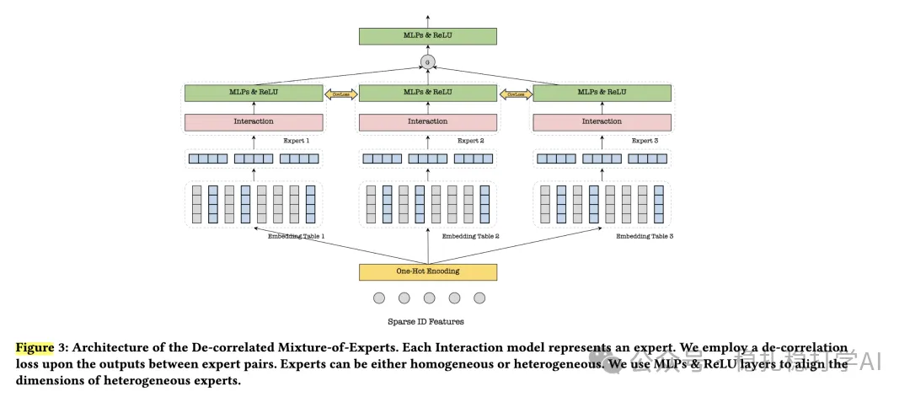

# 推荐算法(2025.6.1)：腾讯D-MoE去相关专家网络提升CTR预估

> 原文：https://mp.weixin.qq.com/s/_esAw4QjZiVvbK8bKdJXmQ
> 作者：算法工程师刘明星（稳扎稳打学AI）| 发表于 2025-06-05
> 本文拆自《推荐算法周报(2025.6.1)：AB效果炸裂的一周》第 4 篇。

关注我，每天为你精挑细选最优质、最新鲜的推荐算法paper，陪你一起保持进步、不断精进！

> [English version](2025-06-05-tencent-d-moe.full.en.md)

Enhancing CTR Prediction with De-correlated Expert Networks

网址：https://arxiv.org/pdf/2505.17925

公司：腾讯

方向：网络优化

解读：

提出了一个D-MoE框架，降低MoE里expert专家的相关性，从而提高建模效果。主要是，每个专家有独立的嵌入表，并增加一个expert之间的去相关性Loss。具体的，

（1）嵌入层：采用多嵌入表设计，每个专家拥有独立的嵌入表，避免嵌入坍塌，增强输入多样性。

（2）专家层：支持同构（Homo-MoE）或异构（Hetero-MoE）专家，专家为特征交互模型（如DCN、CIN、DNN、FM）。

（3）去相关损失（CorrLoss）：定义为专家输出对之间相关性矩阵的L2范数。

（4）门控机制：使用独立门控嵌入（Gating Embedding, GE）和门控网络（Gating Network, GN）计算专家权重，避免对特定专家的偏见。

（5）损失函数：结合二元交叉熵损失（BCE）和去相关损失。

AB效果突出，贴一下：在腾讯广告平台部署D-MoE，基于异构专家和多嵌入架构，加入CorrLoss。一周20%流量A/B测试显示，GMV提升1.02%-2.68%，CTR提升0.95%-2.46%，在多个场景（如Channel pCTR、Moments pCTR）均显著。

心得：专家网络还是要专业，这个方向的工作一直不断。

可信度：生产

推荐等级：推荐看看

Figure 3: Architecture of the De-correlated Mixture-of-Experts. Each Interaction model represents an expert. We employ a de-correlation loss upon the outputs between expert pairs. Experts can be either homogeneous or heterogeneous. We use MLPs & ReLU layers to align the dimensions of heterogeneous experts.
