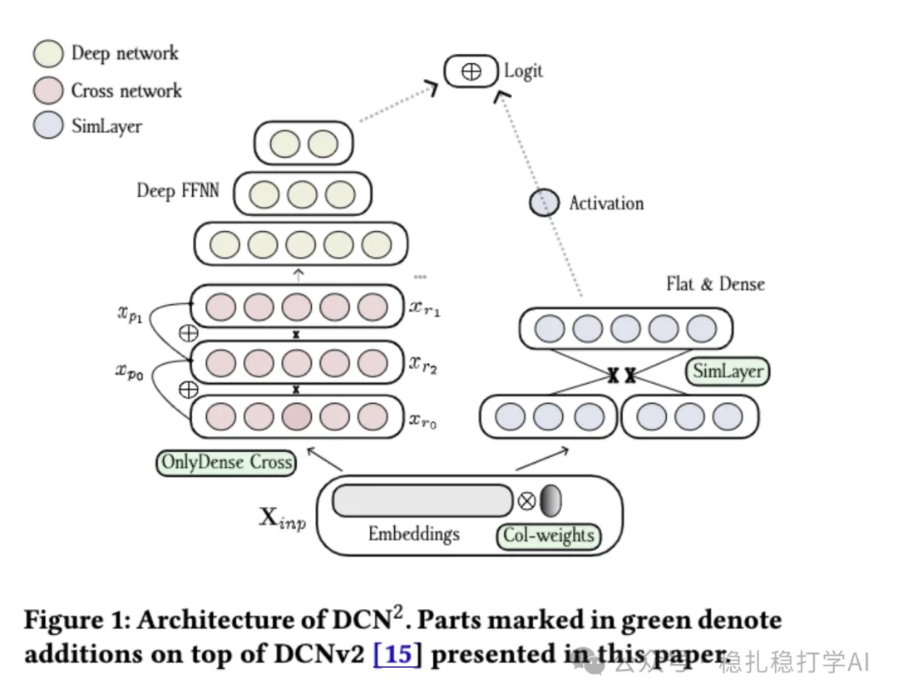

# Daily Pick (2025.6.30): the third version of DCN works well

> [中文版](2025-06-30-teads-dcn2.md)

1 DCN2: Interplay of Implicit Collision Weights and Explicit Cross Layers for Large-Scale Recommendation

Link: https://arxiv.org/pdf/2506.21624

Company: Teads (an ad tech company)

Area: network architecture

Overview:

DCN 2 uses three key algorithmic improvements to address DCNv2's limitations in information loss, collision management, and explicit feature interaction modeling.

DCN 2 improves on DCNv2 through collision weighting, the OnlyDense layer and SimLayer.

Concretely:

(1) In the embedding layer, collision weights are introduced to be aware of collisions

Collision weights reflect the impact of collisions indirectly, driven by prediction error: when multiple feature values map to the same bucket (a collision), that bucket's embedding vector has to represent the semantics of several features at once, which can increase prediction error (because a single embedding cannot fully distinguish different features). During training, gradient descent adjusts that bucket's collision weight (usually down) to reduce its outsized influence on the prediction.

(2) How the OnlyDense layer works

DCNv2's Cross layer uses a low-rank projection to map the input to a lower dimension for the interaction computation, then maps it back to the original dimension. This projection can cause information loss, especially when several Cross layers are applied in a row (because each projection compresses).

The core idea of the OnlyDense layer is to do feature interaction directly in the input's original dimension space (dense space), avoiding projection into a low-dimensional space and thus reducing information loss.

(3) Explicit pairwise interaction (SimLayer)

V2's Cross layer captures interactions through iterative projections or transforms, which leans toward implicit modeling and may not fully emulate explicit pairwise interactions the way FFMs do. SimLayer computes the dot product of every pair of input embeddings to capture similarity between features, and produces an interaction representation through an activation function and a projection. SimLayer also shares the weight matrix, bringing the parameter count and computational complexity down to an acceptable level. In addition, SimLayer's output serves as an extra logit fused directly with the output of the DCN part, strengthening the model's predictive power and making up for the Cross/OnlyDense layers' shortfall in explicit interaction.

The A/B results: in Teads' real-time recommendation system, CTR gained 3.2% RPM, CVR gained 4.2% swCR and 0.37% GR, and CPA dropped 2.8%.

Credibility: production

Recommendation: recommended reading

