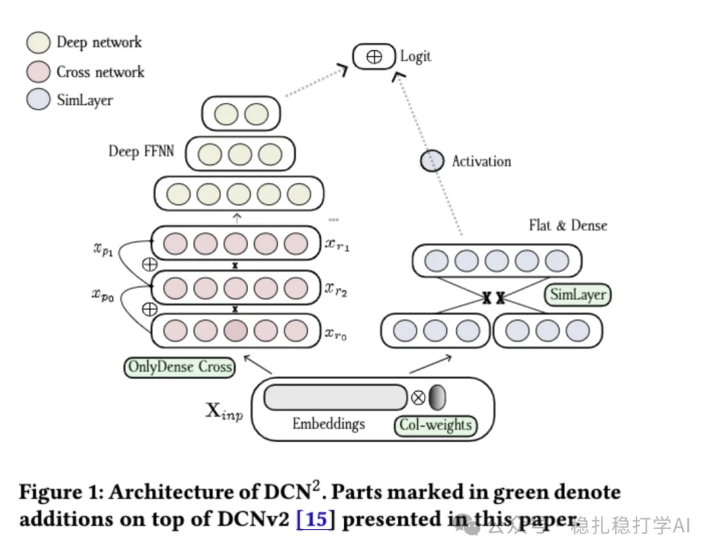

# 推荐算法(2025.6.30)：DCN模型的第三版效果不错

> 原文：https://mp.weixin.qq.com/s/sWt-6xXKMTLlRFDiJd5JUQ
> 作者：算法工程师刘明星（稳扎稳打学AI）| 发表于 2025-06-30

嘿，记得给“稳扎稳打学AI”添加星标

关注我，每天为你精挑细选最优质、最新鲜的推荐算法paper，陪你一起保持进步、不断精进！

> [English version](2025-06-30-teads-dcn2.full.en.md)

👆 [本公众号paper推荐原则](https://mp.weixin.qq.com/s?__biz=MzkzNDYyNjM1NA==&mid=2247484097&idx=1&sn=18322c279290b555eb030e12953b7c7f&scene=21#wechat_redirect)

1 DCN2: Interplay of Implicit Collision Weights and Explicit Cross Layers for Large-Scale Recommendation

网址：https://arxiv.org/pdf/2506.21624

公司：Teads（一家广告科技公司）

方向：网络结构

解读：

DCN 2通过三项关键算法改进，解决了DCNv2在信息丢失、碰撞管理和显式特征交互建模方面的局限性。

DCN 2通过碰撞加权、OnlyDense层和SimLayer增强了DCNv2的性能。

具体的，

（1）在embedding layer层，引入碰撞权重感知碰撞

碰撞权重间接反映碰撞的影响：预测误差驱动：当多个特征值映射到同一桶（碰撞），该桶的嵌入向量需要同时表示多个特征的语义，可能导致预测误差增大（因为单一嵌入无法充分区分不同特征）。在训练过程中，梯度下降会调整该桶的碰撞权重（通常下调），以减少其对预测的过度影响。

（2）OnlyDense层的原理

DCNv2的Cross层通过低秩投影将输入映射到较低维度进行交互运算，随后再映射回原始维度。这种投影过程可能导致信息丢失，尤其是连续应用多个Cross层时（由于每次投影的压缩性质）。

OnlyDense层的核心思想是直接在输入的原始维度空间（dense space）中进行特征交互，避免投影到低维空间，从而减少信息丢失。

（3）显式成对交互（SimLayer）

针对V2的Cross 层通过迭代投影或变换捕获交互，偏向于隐式（implicit）建模，可能无法充分模拟 FFMs 那样的显式成对交互。SimLayer 针对输入嵌入（embeddings）计算每对特征的点积（dot product），捕获特征间的相似性（similarity），并通过激活函数和投影生成交互表示。同时，SimLayer 共享权重矩阵，将参数量和计算复杂度降至可接受水平。另外，SimLayer 的输出作为一个额外的 logit，直接与 DCN 部分的输出融合，增强模型的预测能力，弥补 Cross/OnlyDense 层在显式交互上的不足。

贴一下AB：在Teads的实时推荐系统中，CTR提升3.2% RPM，CVR提升4.2% swCR和0.37% GR，CPA降低2.8%。

可信度：生产

推荐等级：推荐看看

请帮忙点赞、转发，谢谢。您认为哪篇论文最有潜力应用到实际业务中？

## 欢迎干货投稿 \ 论文宣传 \ 合作交流

推荐您继续阅读：

■ [推荐算法周报(2025.6.29)：本周4篇，效果都不错](https://mp.weixin.qq.com/s?__biz=MzkzNDYyNjM1NA==&mid=2247484855&idx=1&sn=6a3fb2e1a6f0c5e3b0e5d02b8c90e9b&scene=21#wechat_redirect)

■ [推荐算法(2025.6.28)：Spotify的混流排序非常有效](https://mp.weixin.qq.com/s?__biz=MzkzNDYyNjM1NA==&mid=2247484849&idx=1&sn=f7a9e14d8eaf5f2c1cba7a9b2d4d0c6&scene=21#wechat_redirect)

■ [推荐算法(2025.6.26)：京东的搜索多模态召回效果明显](https://mp.weixin.qq.com/s?__biz=MzkzNDYyNjM1NA==&mid=2247484843&idx=1&sn=5f26f4c0e5b4c7e0c2a8d0f9f8f8f8&scene=21#wechat_redirect)

历史文章索引：https://docs.qq.com/sheet/DYXZTZ0tseHRyZGtt?tab=BB08J2

由于公众号试行乱序推送，您可能不再准时收到稳扎稳打学AI的推送。为了第一时间收到本号的干货内容， 请将本号设为星标，以及常点文末右下角的“在看”。

喜欢的话点个在看吧👇

个人观点，仅供参考
