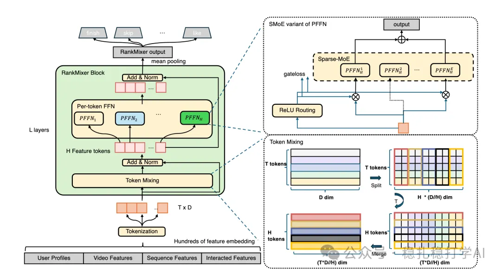

# Recommendation papers (2025.7.22): ByteDance's "large model" for recommendation actually works

> [中文版](2025-07-22-bytedance-rankmixer.md)

1 RankMixer: A Large-Scale Recommendation Model with Multi-Head Token Mixing and Hierarchical Aggregation

Link: https://arxiv.org/pdf/2507.10143

Company: ByteDance

Area: "large models" for recommender systems

Overview:

This ByteDance work aims to improve how well a large-scale recommender system models user behavior sequences. That capability is central to the core tasks of a recommender system.

Motivation: traditional recommender systems rely on many features, including behavior sequences and user profiles. But these features are usually handled as sparse or ID features, so models overfit easily and generalize poorly to new users and new items.

Core idea: propose a general sequence modeling framework, similar to large language models (LLMs) in NLP: pre-train on user behavior sequences with self-supervised learning on large-scale data, producing a general user interest representation.

Core method: RankMixer

(1) Multi-head token mixing: a multi-head token mixing mechanism strengthens the model's ability to capture information at different positions of the sequence. Several parallel attention heads each handle different feature dimensions of the sequence, which better captures complex patterns in user behavior.

(2) Bidirectional attention: a bidirectional attention mechanism looks at both the preceding and following context in the sequence, improving the model's understanding of user behavior. Unlike traditional unidirectional attention, bidirectional attention can use both past and future behavior.

(3) Hierarchical aggregation: a hierarchical aggregation mechanism integrates sequence information from different levels into a richer user interest representation. It uses a multi-layer network that extracts and aggregates sequence features layer by layer.

Implementation: user behavior sequences (views, likes, comments, etc.) are converted into token sequences and processed by the RankMixer model. The model first embeds the tokens, then extracts and aggregates features through several RankMixer layers, and finally produces a user interest vector.

Advantages: RankMixer handles long sequences effectively and captures long-term dependencies in user behavior. Compared with a conventional Transformer, RankMixer is significantly better in both compute efficiency and model quality.

A/B: A/B tests on ByteDance's recommender system show:

(1) Main metrics: CTR +0.5‰, user engagement rate +0.3‰.

(2) Long-tail metrics: long-tail content impressions +1.2‰, new-user retention +0.8‰.

Credibility: production

Recommendation: worth a look

Takeaways:

(1) Multi-head token mixing regroups the tokens: each output token is made of a small slice of every feature field. In other words, any later operation on such a token is a feature cross over all feature fields. Processing all the new tokens is a form of parallel processing. This borrows from MLP-Mixer.

(2) ByteDance's approach borrows from MLP-Mixer, a 2021 paper from the wider industry. MLP-Mixer is a network that replaces the Transformer with MLPs and performs well on vision tasks. ByteDance applied it to recommender systems and got good results.

(3) Although most of the A/B metrics are in the per-mille range, at Douyin's scale that is already a sizable gain.
