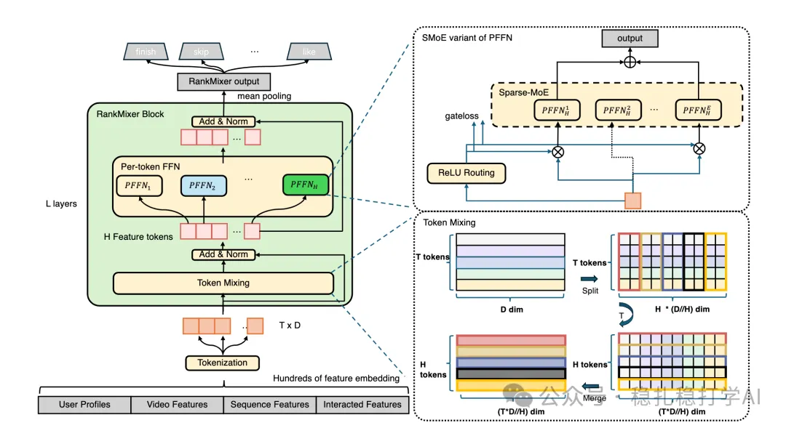

# 推荐算法(2025.7.22)：字节的推荐算法“大模型”有效果

> 原文：https://mp.weixin.qq.com/s?__biz=MzkzNDYyNjM1NA==&mid=2247484908&idx=1&sn=7015e595144e0712fb4401175f50e624&scene=21#wechat_redirect
> 作者：算法工程师刘明星（稳扎稳打学AI）| 发表于 2025-07-22

嘿，记得给“稳扎稳打学AI”添加星标

关注我，每天为你精挑细选最优质、最新鲜的推荐算法paper，陪你一起保持进步、不断精进！

> [English version](2025-07-22-bytedance-rankmixer.full.en.md)

👆 [本公众号paper推荐原则](https://mp.weixin.qq.com/s?__biz=MzkzNDYyNjM1NA==&mid=2247484097&idx=1&sn=18322c279290b555eb030e12953b7c7f&scene=21#wechat_redirect)

1 RankMixer: A Large-Scale Recommendation Model with Multi-Head Token Mixing and Hierarchical Aggregation

网址：https://arxiv.org/pdf/2507.10143

公司：字节

方向：推荐系统的“大模型”

解读：

字节跳动的这个研究，是为了提升大型推荐系统建模用户行为序列的能力。这个能力在推荐系统的核心任务中至关重要。

动机：传统推荐系统依赖于各种特征，包括行为序列和用户画像等。然而，这些特征通常通过稀疏或ID特征处理，导致模型容易过拟合，并且对新用户和新物品的泛化能力不足。

核心思想：提出一个通用的序列建模框架，类似于NLP中的大语言模型（LLM），通过对用户行为序列进行预训练（Pre-training），并在大规模数据上进行自监督学习，生成通用的用户兴趣表示。

核心方法：RankMixer

（1）多头令牌混合：通过多头令牌混合（Multi-head Token Mixing）机制，增强模型对序列中不同位置信息的捕捉能力。该方法通过多个并行的注意力头，分别处理序列中的不同特征维度，从而更好地捕捉用户行为的复杂模式。

（2）双向注意力：采用双向注意力机制（Bidirectional Attention），同时考虑序列中的前后文信息，从而提高模型对用户行为的理解能力。与传统的单向注意力不同，双向注意力能够同时利用过去和未来的行为信息。

（3）分层聚合：通过分层聚合（Hierarchical Aggregation）机制，将不同层次的序列信息进行整合，形成更加丰富的用户兴趣表示。该方法通过多层网络结构，逐层提取和聚合序列特征。

具体实现：将用户行为序列（如观看、点赞、评论等）转换为token序列，并通过RankMixer模型进行处理。模型首先对token进行嵌入（Embedding），然后通过多层RankMixer层进行特征提取和聚合，最终生成用户兴趣向量。

优势：RankMixer能够有效处理长序列数据，捕捉用户行为的长期依赖关系。与传统的Transformer模型相比，RankMixer在计算效率和模型效果上都有显著提升。

AB实验：在字节跳动的推荐系统上进行了AB实验，结果显示：

（1）主要指标：点击率（CTR）提升了 0.5‰，用户互动率提升了 0.3‰。

（2）长尾指标：长尾内容曝光量提升了 1.2‰，新用户留存率提升了 0.8‰。

可信度：生产

推荐等级：推荐看看

心得：

（1）多头令牌混合，实现了重组令牌，输出每个令牌是所有特征field的小部分组成的，换句话说，对该令牌的后续操作就是对所有特征field的特征交叉。对所有新令牌的处理，就是一种并行处理。这个借鉴了有MLP-Mixer。

（2）字节的做法，借鉴了业界的MLP-Mixer，这是一篇2021年的paper。MLP-Mixer是一个用MLP替代Transformer的网络，在视觉任务上表现得很好。字节的做法，是将其用到推荐系统上，并且取得了不错的效果。

（3）虽然AB的大部分指标都是千分位，但是对于体量庞大的抖音，已经是不小的收益。

请帮忙点赞、转发，谢谢。您认为哪篇论文最有潜力应用到实际业务中？

## 欢迎干货投稿 \ 论文宣传 \ 合作交流

推荐您继续阅读：

■ [推荐算法(2025.7.19)：Pinterest出品必是精品——GPT建模行为序列](https://mp.weixin.qq.com/s?__biz=MzkzNDYyNjM1NA==&mid=2247484902&idx=1&sn=2ebdcda5dceefb8d2608f48bdeaab839&scene=21#wechat_redirect)

■ [推荐算法(2025.7.16)：Meta的相关短视频推荐的相关性提升了12%](https://mp.weixin.qq.com/s?__biz=MzkzNDYyNjM1NA==&mid=2247484896&idx=1&sn=00e46baa7b3bedc78520a72f4360ee74&scene=21#wechat_redirect)

■ [推荐算法(2025.7.15)：淘宝的长序列召回新方法GMV增长4个点](https://mp.weixin.qq.com/s?__biz=MzkzNDYyNjM1NA==&mid=2247484890&idx=1&sn=a0f75d4b0b5396e9efb6ad35af31f804&scene=21#wechat_redirect)

历史文章索引：https://docs.qq.com/sheet/DYXZTZ0tseHRyZGtt?tab=BB08J2

请入群，群内可讨论技术方案、发招聘广告、内推和交友。

• 铁粉标准：累计10次评论或爱心、投稿1次。

• 入群方法：请您加个人微信lmxhappy，我拉您入群，请备注（只我个人看，不公开）。

由于公众号试行乱序推送，您可能不再准时收到稳扎稳打学AI的推送。为了第一时间收到本号的干货内容， 请将本号设为星标，以及常点文末右下角的“在看”。

喜欢的话点个在看吧👇

个人观点，仅供参考
