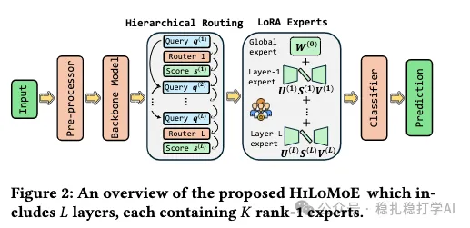

# Recommendation papers (2025.10.21): Meta's CTR model really nails dynamic networks

> [中文版](2025-10-21-meta-hilomoe.md)

1 Hierarchical LoRA MoE: A Parameter-Efficient Approach to Mixture-of-Experts

Link: https://arxiv.org/pdf/2510.10432

Company: Meta

Idea: dynamic networks (LoRA, routing, MoE) + CTR modeling (long sequences)

Area: CTR modeling

Overview: this paper mainly uses dynamic-network methods to dynamically adjust the network structure used for sequence modeling. Specifically:

(1) LoRA MoE

1) Feature processing. Input features first go through the embedding layer, then through a pre-trained backbone network to get feature representations.

2) Layer structure. In the backbone, every layer has a router and a set of LoRA experts. The router decides which LoRA experts each sample should use, and the LoRA experts transform the features.

3) Routing. The router outputs a weight vector giving the weight of each LoRA expert. Specifically: the router first applies a linear transform to the input features to get a score vector, then applies softmax to the score vector to get the weight vector.

4) LoRA experts. Each LoRA expert is a low-rank matrix factorization network. Specifically: each LoRA expert consists of two matrices, a down-projection matrix and an up-projection matrix. Their product gives a low-rank transformation matrix.

5) Relationship between layers. The output of the previous layer goes through a linear transform and becomes the input of the next layer. The benefit: each layer can dynamically adjust its own parameters based on the previous layer's output.

6) Output. The output of the last layer is fed into a classifier to get the final prediction.

(2) Special handling

1) Two special pieces: a global expert and layer experts. The global expert is an independent network that does not depend on any layer; a layer expert is a network specific to each layer and depends only on that layer.

2) Routing. The global expert's routing: apply a linear transform to the input features to get a score, then apply sigmoid to the score to get a weight. The layer experts' routing: apply a linear transform to the input features to get a score vector, then apply softmax to get a weight vector.

Takeaways: (1) The idea of this paper is very simple and direct: use dynamic-network methods to dynamically adjust the network structure for sequence modeling. The benefit is that the network structure can be adjusted per sample, which improves the model's expressiveness. (2) The LoRA MoE structure here is also well worth borrowing. LoRA MoE lets the model adjust its structure dynamically without adding many parameters, which improves performance.

Caveats: to show that generating the weights is not hard, the paper stresses parallelism. Cross-layer parallelism is real, but stressing it does not change the fact that the overall architecture still runs sequentially.

Credibility: offline

Recommendation: worth a look

