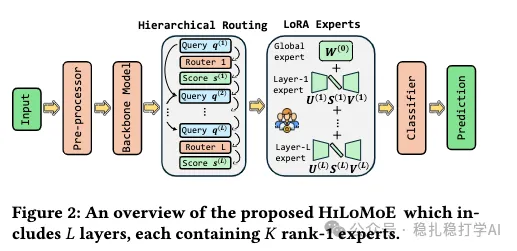

# 推荐算法(2025.10.21)：meta的CTR模型，动态网络玩的真6啊

> 原文：https://mp.weixin.qq.com/s/hEmQcaD5RSjcarkFq9_PWg
> 作者：算法工程师刘明星（稳扎稳打学AI）| 发表于 2025-10-21

嘿，记得给“稳扎稳打学AI”添加星标

关注我，每天为你精挑细选最优质、最新鲜的推荐算法paper，陪你一起保持进步、不断精进！

> [English version](2025-10-21-meta-hilomoe.full.en.md)

👆 [本公众号paper推荐原则](https://mp.weixin.qq.com/s/BhVGu0qH5kTz9N5zpsD3KA)

1 Hierarchical LoRA MoE: A Parameter-Efficient Approach to Mixture-of-Experts

网址：https://arxiv.org/pdf/2510.10432

公司：meta

思想：动态网络（LoRA、路由、MoE）+ctr建模（长序列）

方向：CTR建模

解读：本文主要用动态网络方法，为序列建模的网络结构做动态调整。具体的：

（1）LoRA MoE

1）特征处理。输入特征先经过embedding层，再通过一个预训练的backbone网络，得到特征表征。

2）层结构。backbone网络中，每一层都有一个router和一组LoRA expert。router负责决定每个样本应该使用哪些LoRA expert，而LoRA expert则负责对特征进行变换。

3）路由方法。router的输出是一个权重向量，表示每个LoRA expert的权重。具体的：router先对输入特征做一个线性变换，得到一个分数向量；然后，对分数向量做softmax，得到权重向量。

4）LoRA expert。每个LoRA expert都是一个低秩矩阵分解的网络。具体的：每个LoRA expert由两个矩阵组成，一个是降维矩阵，一个是升维矩阵。通过这两个矩阵的乘积，可以得到一个低秩的变换矩阵。

5）层间关系。上一层的输出，经过一个线性变换，作为一下层的输入。这样的好处是：每一层都可以根据上一层的输出，动态调整自己的参数。

6）输出。将最后一层的输出，输入到一个分类器中，得到最终的预测结果。

（2）特殊处理

1）两点特殊输处理：全局expert和层级expert。全局expert是一个独立的网络，不依赖于任何一层；层级expert是每一层独有的网络，只依赖于该层。

2）路由方法。全局expert的路由方法是：对输入特征做一个线性变换，得到一个分数；然后，对分数做sigmoid，得到权重。层级expert的路由方法是：对输入特征做一个线性变换，得到一个分数向量；然后，对分数向量做softmax，得到权重向量。

心得：（1）本文的思路非常简单直接：用动态网络方法，为序列建模的网络结构做动态调整。这种方法的好处是：可以根据不同的样本，动态调整网络结构，从而提升模型的表达能力。（2）本文的LoRA MoE结构也非常值得借鉴。LoRA MoE可以让模型在不增加太多参数的情况下，动态调整网络结构，从而提升模型的性能。

愚见：为了体现本文生成weights的难度不大，强调并行，但是跨层并行这个虽然是事实，但是强调并不改变顺序执行的大架构。

可信度：离线

推荐等级：推荐看看

请帮忙点赞、转发，谢谢。

## 欢迎干货投稿 \ 论文宣传 \ 合作交流

推荐您继续阅读：

■ [推荐算法(2025.10.14)：meta的跨域方法，贴心的详细探讨了生效原理](https://mp.weixin.qq.com/s/b2QXIxOtFWNpY95N9_GRAw)

■ [推荐算法(2025.10.10)：谷歌的，用LLM给短视频打标签的工业落地方案](https://mp.weixin.qq.com/s/o2WlE_W2lAX8mMEq_02g0A)

历史文章索引：https://docs.qq.com/sheet/DYXZTZ0tseHRyZGtt?tab=BB08J2

请入微信群，群内我会给出更深入的解读，还可以共同讨论技术方案、发招聘广告、内推和交友等。

• 铁粉标准：关注公众号一个月以上，且在公众号上累计15次互动（评论、爱心、转发）、或投稿1次、或打赏199。

• 入群方法：请您加个人微信lmxhappy，我拉您入群，请备注（只我个人看，不公开）。

喜欢的话点个在看吧👇

个人观点，仅供参考
