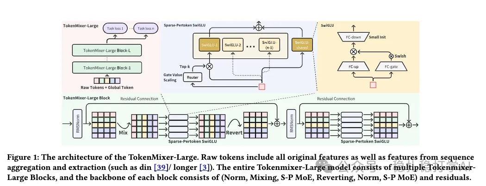

# Recommendation papers (2026.2.10): ByteDance RankMixer 2.0, GMV +3%

> [中文版](2026-02-09-bytedance-rankmixer-2.md)

1 RankMixer 2.0: Towards Massive and Fine-Grained Sparse Mixture of Token Mixers for Sequential Recommendation

Link: https://arxiv.org/pdf/2602.04137

Company: ByteDance

Area: feature crossing, model architecture

Overview:

RankMixer is a feature crossing method ByteDance proposed in 2025. The core change is to what used to be done as "concatenate a pile of features, then cross them". Instead, every feature is tokenized separately, one token per feature, with 96-dim token embeddings per layer. Then attention is done along the token dimension to get the feature-crossing result.

Note: RankMixer is not a sequence model. It is a feature crossing method that models feature crossing as a sequence model.

This is the second version of RankMixer, mainly an extension of it.

(1) Tokenization

User profile features, context features, sequence features and candidate item features are all tokenized. The user's context and profile features are concatenated into one token. The candidate item's features are concatenated into one token. Each item in the user behavior sequence has its features concatenated into its own token.

"Concatenation" here means concat all the features, then use a single-layer perceptron to change the dimension.

(2) Feature fusion

This follows RankMixer's method: the token mixer structure is unchanged, but the capacity of each TokenMixer-Large is increased: token embedding goes from 96 to 192 dims, token mixer width goes to 16x per layer (more parameters), and the feed-forward network changes from a plain MLP to SwiGLU.

(3) MoE

Going further, it becomes a sparse MoE: the SwiGLU is "cloned" into several copies as sub-experts, and a router gate sparsely activates some of them, achieving parameter scaling and efficiency. In addition, each token has its own dedicated shared expert, which improves stability. This is the Sparse-Pertoken MoE.

The router gate is a dense layer with softmax activation that computes attention over the M experts; the top-k experts are activated and the others are not. The activated attention weights sum to less than 1, so they are multiplied afterwards by a fixed number greater than 1. This keeps the MoE sparse while keeping gradients large enough. All of this is for building a bigger network.

(4) Revert

After RankMixer's mixing operation, a revert operation is added so the layer's output has the same dimension as its input. There are two purposes: first, to support a smooth residual connection; second, only then can multiple TokenMixer-Large blocks be stacked.

(5) Inter-layer residuals

Inter-layer residuals (added every 2-3 layers) address vanishing gradients. That is, the outputs of TokenMixer-Large at different layers (lower layers such as layers 2, 4, 6) go through a shared auxiliary tower (also called a head/MLP) to compute logits. These per-layer logits are weighted and summed into a joint logit.

A/B: GMV +3%. The paper's deployment in the ads system is very significant, with GMV up 3%.

Takeaways:
(1) The feature-interaction part of recommender systems looks more and more like LLMs, shifting from traditional feature engineering toward "sequence modeling".
(2) Recommender model parameters will keep growing, models will keep getting bigger, and results will keep getting better.
(3) The MoE method in this paper is worth referencing; although it is used to scale up parameters, it did not bring a matching gain.
(4) This paper's method is very similar to Meta's LLaTTE model from January 29. LLaTTE is an offline + online model combination; this one is more of a purely online model.

Credibility: production

Recommendation: practically useful

