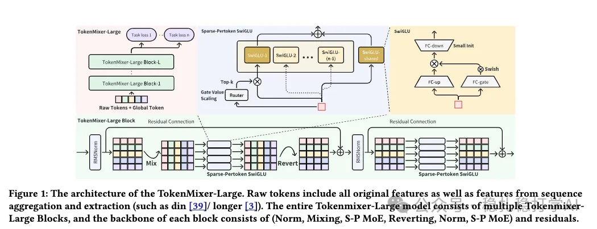

# 推荐算法(2026.2.10)：字节RankMixer 2.0，GMV+3%

> 原文：https://mp.weixin.qq.com/s/35wtwtJ629_e1JvFc7gPGg
> 作者：算法工程师刘明星（稳扎稳打学AI）| 发表于 2026-02-09

嘿，记得给“稳扎稳打学AI”添加星标

关注我，每天为你精挑细选最优质、最新鲜的推荐算法paper，陪你一起保持进步、不断精进！

👆 [本公众号paper推荐原则](https://mp.weixin.qq.com/s/BhVGu0qH5kTz9N5zpsD3KA)

1 RankMixer 2.0: Towards Massive and Fine-Grained Sparse Mixture of Token Mixers for Sequential Recommendation

网址：https://arxiv.org/pdf/2602.04137

公司：字节

方向：特征交叉，模型结构

解读：

RankMixer是字节2025年提出的特征交叉方法，核心是将原来一堆特征先拼接，然后做特征交叉。先把所有特征分别token化，每个特征一个token，每层token embedding 96维。然后在token维度做attention，以获取特征交叉的结果。

这里需要注意，RankMixer不是序列模型，它是一种特征交叉方法，把特征交叉建模为序列模型。

这篇是RankMixer的第二版，主要是对RankMixer进行扩展。

（1）token化

将用户画像特征、上下文特征、序列特征、候选物品特征，全部做token化。用户的上下文和画像特征，拼接为一个token。候选物品特征，拼接为一个token。用户行为序列中的每个item特征，各拼接为一个token。

这里的拼接是concat所有特征，然后用单层感知机变换维度。

（2）特征融合

这里沿用RankMixer的方法，token Mixer结构不变，但是每个TokenMixer-large的容量提升：token embedding 96维提升为192维，token Mixer的宽度提升为每层16倍（参数量提升），前馈网络从普通MLP替换为SwiGLU。

（3）MoE

更进一步的，提升为sparse MoE。即将这样的SwiGLU “复制分身” 多份作为多个子专家，然后通过 router gate 稀疏激活其中部分专家，以实现参数扩展和效率优化。另外，每个token有专用共享专家，提升稳定性。这就是Sparse-Pertoken MoE 。

其中，router gate是激活函数为softmax的dense层，为M个专家计算注意力，取top-k的expert激活，其它expert不激活。激活的注意力和小于1，所以在其后乘以一个大于1的固定数。这样保证了sparse moe，又能保证梯度足够大。这都是为了做大网络。

（4）还原

在RankMixer的Mixing操作之后，增加一个还原操作，是为了让该层输出的维度跟输入的维度一样。目的有两个，第一个是支持平滑残差连接；第二个模型如此才能堆叠多个TokenMixer-Large Block。

（5）层间残差

层间残差（每隔2-3层添加）解决梯度消失。即不同层（低层如第 2、4、6 层）的 TokenMixer-large的 输出，会经过一个共享的辅助 tower（auxiliary tower，或称 head/MLP），用于计算 logits。这些不同层的logits ，加权求和获得联合 logit。

AB：GMV+3%。论文在广告系统中的落地效果非常显著，GMV提升3%。

心得：
（1）推荐系统的特征交互部分越来越像LLM，从传统的特征工程向着“序列建模”转变。
（2）推荐系统的模型参数会越来越大，模型也会越来越大，效果也会越来越好。
（3）这篇的MoE方法可以参考，虽然是用来扩大参数的，但是没有带来对应的收益。
（4）这篇的方法和1月29日的Meta的LLaTTE模型很像。LLaTTE是离线+在线模型组合，这篇更像是纯在线模型。

可信度：生产

推荐等级：有实践价值

请帮忙点赞、转发，谢谢。

## 欢迎干货投稿 \ 论文宣传 \ 合作交流

推荐您继续阅读：

[推荐算法(2026.2.7)：谷歌的物料打标签agent](https://mp.weixin.qq.com/s/iRYxA_B-U7tWpYcuBx9fuQ)

[推荐算法(2026.2.6)：百度，长序列CTR建模，广告平均收入+3%](https://mp.weixin.qq.com/s/iVOIfoNyrxYrj5dZpMKu0g)

历史文章索引：https://docs.qq.com/sheet/DYXZTZ0tseHRyZGtt?tab=BB08J2

请入微信群，群内我会给出更深入的解读，还可以共同讨论技术方案、发招聘广告、内推和交友等。

铁粉标准：关注公众号一个月以上，且在公众号上累计15次互动（评论、爱心、转发）、或投稿1次，只欢迎技术同学。

入群方法：请您加个人微信lmxhappy，我拉您入群，请备注（只我个人看，不公开）。

喜欢的话点个在看吧👇

个人观点，仅供参考
