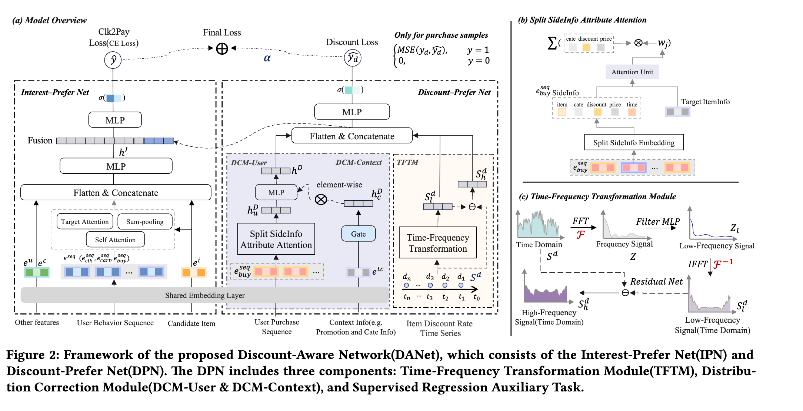

# Alibaba models product discount rate explicitly, GMV +2%

> [中文版](ali-danet.md)

### Paper: Cheaper is Better: A Discount-Aware Network for Conversion Rate Prediction in E-commerce Recommendation System
### Link: https://arxiv.org/pdf/2607.12578
### Company: Alibaba
### Idea: explicit modeling
### Area: feature crossing

## Overview:
This paper adds an auxiliary network that models the discount rate (item-side trend + user-side preference) to improve CVR modeling. That is, it adds an auxiliary network that processes the item's discount information (with a matching auxiliary task, called DPN). The 3 intermediate representations it produces, $h_D$, $S^d_h$ and $S^d_l$, are concatenated into the second half of the main network (IPN), strengthening the main network's CVR modeling.

Discounts strongly affect conversion, but earlier work either treated them as ordinary features or modeled price directly (which is hard). This paper uses the discount rate in place of price, and models it systematically with a dedicated network from two angles: "the item's long-term/short-term discount trend" and "the user's personalized discount preference".

The auxiliary network is built from two parallel modules: time-frequency decomposition of the item-side discount sequence, and user-side discount preference modeling. They produce the item's discount trend representation and the user's discount preference representation, which are concatenated and passed through an MLP to predict the discount rate at the moment the user actually bought the item. This gives an MSE loss (on positives; for negatives the target is set to 0), trained jointly as an auxiliary task with the main task.

### Item side: time-frequency decomposition of the discount sequence
The input is the target item's daily discount rate time series over the past 400 days. With time-frequency decomposition, the model perceives both the "long-term discount level" and "short-term discount changes", which works better than feeding the raw discount sequence in directly.
Processing steps:

1. Apply FFT (fast Fourier transform) to the time series to get the spectrum: $$Z = \text{FFT}(S^d)$$
2. Filter the spectrum with an MLP $f_t(\cdot)$ (learning the importance of different frequency components, mainly keeping stable low-frequency information): $$Z_l = f_t(Z)$$
3. Apply IFFT to go back to the time domain, giving the low-frequency trend signal: $$S^d_l = \text{IFFT}(Z_l)$$
4. Extract the high-frequency component as a residual: $$S^d_h = S^d - S^d_l$$

The two discount trend representations $S^d_h$ and $S^d_l$ are fed into the downstream model.

### User side: discount preference modeling
Computation:
* DCM-User: target attention over the user's historical purchase sequence gives the user discount representation $h^u_D$, which represents "this user's discount preference on similar items". In the target attention, each sequence item is represented by the item's own embedding, category, discount, price and purchase time; the attention is computed between sequence items and the target by a small MLP.
* DCM-Context: promotion-related context features go through a GateNet implemented as an MLP, producing a gating vector.
* Combining the two: multiply the user discount preference by the scenario gating vector for dynamic adjustment. The resulting $h^D$ is the user discount preference representation after personalization + scenario correction.

**The logic of DCM-User**

Different users react very differently to the same item's discount. Some will only buy during a big promotion; some will order as soon as it is a bit cheaper. Modeling the historical purchase sequence is specifically meant to capture this personalized discount preference. The core question this module answers: how sensitive is this user to discounts, really? At what discount level do they usually place an order? **Why use only the "purchase sequence" and not the click sequence?** Clicks are too many and too noisy; many are just browsing and don't reflect what price the user truly accepts. A purchase happens at the final step of the decision; it is when the user actually pays that the acceptable discount level shows best. So DCM-User uses only the user's historical purchase sequence (buy sequence).

**The logic of DCM-Context**

Promotion-related context features include whether a big promotion is currently running, the specific campaign type (spend-and-save, flash sale, cross-store, etc.), time features (weekend or not, holiday or not), and other platform campaign signals. The authors borrow the gating idea from models such as PEPNet: a GateNet uses the current promotion context to dynamically generate a "scenario bias vector" that adjusts the user discount preference learned above. Its job is to tell the model "how the user's discount preference representation should be adjusted under the current promotion environment". The problem it solves: the same discount rate means different things "on a normal day" and "during a big promotion". For example, 20% off may already be attractive on a normal day, but during big promotions like Singles' Day (11.11) or 618, 20% off may be just the starting point and users expect more. Without distinguishing the scenario, the model would wrongly treat "high discounts during big promotions" as the user's own preference, introducing bias. DCM-Context exists specifically to correct this periodic, scenario-driven systematic bias.

### A/B:
Tmall homepage: pCVR +3.63%, GMV +2.23%, share of impressions going to discounted items (PVR) from 7.56% to 11.14% (+47.32%).

## Takeaways:
* Explicit modeling: take a key feature that was implicitly drowned out and promote it to an object modeled explicitly and in depth by a dedicated network.
* Earlier models may have leaned toward pushing items that "match user interest" and were not sensitive enough to price/discount. After DANet went live, on top of interest matching the model additionally learned "whether this discount is worth recommending", so it actively raised the exposure weight of heavily discounted items.

## Credibility: production

## Recommendation: practically useful
