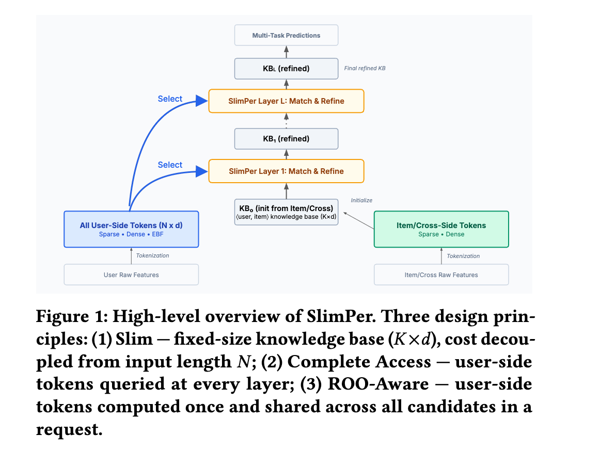

# Meta: a multi-layer, multi-slot enhanced Target Attention, big gains in business metrics

> [中文版](meta-slimper.md)

### Paper: SlimPer: Make Personalization Model Slim and Smart
### Link: https://arxiv.org/pdf/2607.12281
### Company: Meta
### Idea: stacking
### Area: feature crossing

## Overview:
This paper proposes a new behavior sequence modeling method: tokenize the user features, use an enhanced Target Attention to retrieve user evidence conditioned on the current item, then accumulate this evidence layer by layer through "explicit matching + careful refinement", and finally output the prediction from the accumulated result.

Before the rest, one concept needs introducing, the **Knowledge base**: the non-user features (item features, context features and cross features) are concatenated and passed through a linear transform, giving a matrix of shape (K, d). The paper calls this matrix the Knowledge base (KB for short).

### Tokenizing user features
The model first turns all features (including long sequences) into tokens.
* Sparse features: through pooling, ultimately compressed into 1 (or a very few) fixed-dimension vectors.
* Dense features: concatenated and passed through an MLP to get one token.
* Sequence features: for each sequence item, its various pieces of information are fused into a corresponding token. In particular, this process also fuses information from the preceding and following items in the sequence.

### Enhanced Target Attention layer
The non-user features are organized as the Query; the user's sparse-feature tokens and sequence tokens each serve as Key/Value for Target Attention, producing two pieces of evidence.

The KB goes through a linear transform to get a matrix of shape (q, d), which is the Query. The Query is computed against the sparse-feature tokens and the sequence tokens separately, in slightly different ways:
* User sparse tokens: the sparse tokens (one or several) serve as Key/Value. Processing: the Query vector is paired with each sparse token, an MLP gives the attention, and a weighted sum gives R𝑠.
* Behavior sequence: the user behavior sequence serves as Key/Value. Processing: the Query vector takes the inner product with each sequence item token to get attention, followed by Softmax and a weighted sum, giving R𝑒.

R𝑠 and R𝑒 from this layer are the user evidence retrieved conditioned on the current item.

### KB update layer

R𝑠 and R𝑒 from the layer above are each explicitly dot-multiplied with the target to get similarities 𝝀𝑠 and 𝝀𝑒. Note that the target goes through a linear transform before this.

The similarities 𝝀𝑠/𝝀𝑒, the KB and the dense token are concatenated, transformed by an MLP, and added back to the original Knowledge Base as a residual, giving the updated Knowledge Base. Note that before concatenation, the similarities go through RMSNorm and the KB goes through a linear projection.

Refine uses $\lambda$ rather than $R$ so that the Knowledge Base update is based on the assessment of "how well the new evidence matches the current understanding", instead of directly absorbing the retrieved evidence vectors. This reflects the design philosophy the paper wants to stress: "explicit matching + careful refinement".

The enhanced Target Attention layer and the KB update layer are stacked, updating the KB each time. Note that every layer shares the same copy of the 3 kinds of user features described above, which are not updated.

Finally, the prediction head produces the multi-task logits from the refined KB. The raw user or item features are not concatenated back into the upper network, because they have already been fully folded into the KB computation above.

### A/B:
Deployed on full traffic in Reels (5k events) and Feed (4k events). Several main engagement metrics got statistically significant positive gains; the aggregate topline impact (the business's top-level core metrics) is about 10x a typical significant launch (roughly on the order of 1% to 3%).

## Takeaways:
* This paper gave me a deeper understanding of target attention.
* Historically many people tried to break through target attention and stack it to get scaling-law gains; this paper comes closest.
* The Knowledge Base uses a multi-slot design, with a "multi-view expressiveness" similar to multi-head attention, but a different mechanism.

## Caveats
* The paper tries to present a brand-new perspective through the Knowledge base. The downside is that it makes the paper harder to read. Framing it as stacking target attention would probably be easier to read.

## Credibility: production

## Recommendation: practically useful

