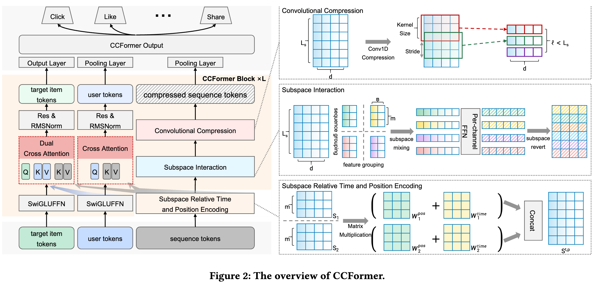

# Tencent: hierarchical long-sequence compression + directed three-field crossing, ad revenue up to +1.71%

> [中文版](tencent-ccformer.md)

### Paper: CCFormer: Efficient Cross-Field Interaction and Hierarchical Sequence Compression for Industrial Recommendation at Tencent
### Link: https://arxiv.org/pdf/2607.28070
### Company: Tencent
### Idea: divide and conquer, injecting priors, hierarchical compression, MLP in place of attention
### Area: feature crossing, long-sequence modeling

## Overview:
This paper proposes a method for long-sequence modeling, plus a method for feature crossing among 3 fields: user tokens, item tokens and behavior sequence tokens.

First the behavior sequence modeling: encode local relative time and relative position information onto the sequence items, then model local content-dependent relations, and finally compress the sequence globally.

### Local relative time-position awareness in the sequence
Each sequence item gets local awareness. It uses fixed, non-overlapping windows, not sliding windows.
Specifically:
* Cut the whole behavior sequence into multiple non-overlapping groups of fixed length m.
* Within each group, independently compute a relative time + relative position matrix, used as the "attention score" among items in the group, to linearly mix the items in the group.
* Blocks neither overlap nor slide.

The time-position encoding is content-independent (it only looks at time and position).

### Local token mixing in the sequence
Model dependencies inside local sequence windows. The paper does not use full-sequence self-attention, but subspace token mixing: reshape the sequence obtained from the time-position step into subspaces, apply a gated FFN independently to each channel, and finally restore the original shape, giving $\hat{\mathbf{S}}$. Token mixing is content-dependent (it mixes nonlinearly based on the tokens' own features).

This mixes the token dimension and the feature dimension together within local subspaces, with expressiveness close to self-attention but much lower complexity. Input and output shapes stay the same.

**Reshape:**

"Pack" $m$ adjacent tokens and $n$ feature dimensions into one long vector, so a small FFN can mix them nonlinearly together. It breaks down into "group + flatten" along two dimensions:

1. Group along the sequence dimension
Split the length-$L_s$ sequence into groups of $m$ adjacent tokens.
That gives $\frac{L_s}{m}$ groups in total.
2. Group along the feature dimension
Split the $d$-dim features into groups of $n$ dimensions.
That gives $\frac{d}{n}$ channel groups in total.
3. Flatten
For each "sequence group + feature group" combination, flatten its $m$ tokens × $n$ features into a long vector of length $m \times n$. Each $\mathbf{X}_{b, p, c}$ is then a vector in $\mathbb{R}^{mn}$ that contains both:
    * the $m$ behaviors in the $p$-th sequence window
    * the $n$ dimensions in the $c$-th feature channel group

### Hierarchical compression
Strided 1D convolutions shorten the behavior sequence layer by layer while letting each token see an ever longer history, achieving both "lower compute + larger receptive field".

Stacking the 3 steps above completes the sequence modeling and yields a shorter token sequence, which goes through a pooling layer into the upper network for multi-objective modeling.

### Feature crossing
User profile, historical behaviors and the target item are explicitly split into three independent fields, and directed cross-attention lets them interact early in a targeted way, instead of mixing all features together in a global self-attention.

User features and item features are grouped by semantics; each group goes through an FFN to get one token, giving a user token sequence and an item token sequence.
The feature crossing is:
* User tokens generate Queries that attend to the Behavior Sequence.
* Target item tokens generate Queries that attend to the Behavior Sequence and to the User field, respectively.

The attention is standard masked scaled-dot-product attention.

Feature crossing yields crossed user tokens and item tokens. The former go through a linear projection layer; the latter go through a pooling layer. The two resulting representations also go into the upper network for multi-objective modeling.

### A/B:
* Video recommendation: CTR +3.57%, UCTR +1.93%, ad revenue +1.64%
* Ad ranking: ad revenue +1.71%

## Takeaways:
* Feature crossing work does not become redundant because of LLMs; it becomes even more necessary, and there is more to do. In the past two years there has been a lot of work on feature crossing over multiple feature types.
* Divide and conquer is the thread running through the whole paper. The sequence is cut into non-overlapping groups of fixed length m; the d-dim features are cut into channel groups of n; user profile / historical behaviors / target item are explicitly split into three independent fields. Every place does "cut into blocks first, process each block on its own", rather than throwing everything into one global operator.

## Credibility: production

## Recommendation: practically useful
