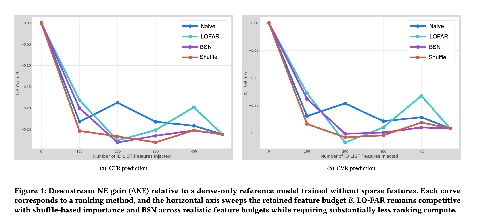

# Meta: a low-cost feature selection method that ranks features without GPUs and cuts sparse parameters by up to 75%

> [中文版](meta-lo-far.md)

### Paper: LO-FAR: A Cost-Aware Local Filter for Sparse Feature Ranking in Industrial Ad Recommendation
### Link: https://arxiv.org/pdf/2607.20873
### Company: Meta
### Idea: divide and conquer, statistics instead of learning
### Area: feature selection

## Overview:
This paper proposes a low-cost way to estimate the importance of ID-list features, so that important features are kept and unimportant ones are dropped. The idea: for each feature independently, use the feature's own "prior / empirical probability" as the prediction and compute the log loss. The smaller the log loss, the stronger the feature's power to predict the label on its own, and therefore the more important it is.

**Background**: in industrial ad CTR/CVR models, sparse ID-list features (user history, context ID lists, etc.) dominate almost everything; for example they usually account for more than 97% of parameters (each feature has its own embedding table). When there are hundreds of candidate features and they need to be re-ranked often, the marginal accuracy gain of today's mainstream feature selection methods is often cancelled out by "rerun cost + decision lag".

### Stage 1: Sampling
From the full logs, sample about 1M interactions stratified by positive/negative label, keeping the positive/negative ratio close to the real distribution. An industrial setting doesn't need an exact ranking over the full data, only a ranking that is "stable enough and quick to rerun". A 1M sample size is a pragmatic trade-off between accuracy and time.

### Stage 2: Train / Test Split
Do one more label-stratified train/test split on the sampled data. This keeps the later evaluation held-out and avoids the optimistic bias of building the tables and scoring on the same data.

### Stage 3: Feature expansion
For both the training and test sets, expand the variable-length ID list $x_i^{(j)} = [id_{i,1}^{(j)}, id_{i,2}^{(j)}, \dots, id_{i,k_i}^{(j)}]$
into "one row per ID occurrence", copying the original sample's label $y_i$. Empty lists are filled with the placeholder $-1$.
Formally:
$$\mathcal{D}^{(j)}_{\text{train,exp}} = \bigl\{(id_{i,t}^{(j)}, y_i) : t=1,\dots,k_i,\ i\in I_{\text{train}}\bigr\}$$
Why expand?
Because raw ID lists are variable-length and hard to model directly. After expansion, the problem reduces to a standard "ID → label" mapping, which can be solved with very simple frequency counts.

### Stage 4: Estimating positive probability
On the training set, for each sparse ID-list feature, learn a simple "ID → click/conversion probability" mapping on its own, completely independent of other features and with no neural network. For every ID in the current feature's vocabulary, estimate its positive probability $s_j(id) \in [0,1]$. Two cases:

1) High-frequency IDs (occurrence count ≥ $K$)

Compute the empirical positive rate directly:
$$s_j(id) = \frac{N_{+}(id)}{N(id)}$$
where $N(id)$ is the total number of occurrences of the ID and $N_{+}(id)$ is the number of those with label=1. This is the most naive and also the most stable estimate. High-frequency IDs have enough samples that this frequency is already reliable.

(2) Low-frequency / unseen IDs (occurrence count < $K$)

With too few samples, computing the frequency directly overfits badly (it can even be 0 or 1). In this case a k-Nearest Neighbor fallback is used: in the feature's vocabulary, find the $K$ high-frequency IDs "most similar" to the current ID, and take a weighted average of these neighbors' empirical positive rates as the estimate for the rare ID. Note that the weighting takes the neighbors' occurrence frequencies into account.

### Stage 5: Aggregating positive probability for test samples
On the test set, aggregate the ID-level scores back to the original samples with a mean:
$$\hat{y}_i^{(j)} = \frac{1}{k_i} \sum_{t=1}^{k_i} s_j(id_{i,t}^{(j)})$$
Intuitively: average the "estimated click/conversion probability" of each ID in the list, and use that as this feature's overall prediction for the sample.

### Stage 6: Scoring and ranking
On the test set, compute each feature's log loss from the predictions and labels:
$$\text{LogLoss}_j = -\frac{1}{N_{\text{test}}} \sum_i \Bigl[ y_i \log \hat{y}_i^{(j)} + (1-y_i)\log(1-\hat{y}_i^{(j)}) \Bigr]$$
Sort by log loss from small to large (that is, predictive power from strong to weak). AUC and Average Precision are only auxiliary diagnostics.
The final output is a feature list sorted by predictive value in descending order.

Why the main metric has to be log loss rather than AUC: the downstream online metric NE (Normalized Entropy) is itself a normalized version of log loss, so ranking by log loss makes the selection yardstick match the downstream objective. AUC only looks at ordering, not calibration, and is insensitive to "how much NE degrades if this feature is removed".

### Results:
Ranking 475 features takes only CPUs, no GPUs, and about 2 hours, with downstream NE roughly on par with Shuffle / BSN (the two baseline methods the paper compares against; see the notes below). It brings a 40%–75% reduction in sparse embedding parameters.

### Note 1: Shuffle-based permutation importance
A classic model-agnostic feature importance method, originating from permutation importance in random forests (Breiman), and later widely used in deep learning.
Steps:
1. First train a full downstream model (with all candidate sparse features).
2. On a held-out validation set, randomly shuffle the values of one feature while keeping the other features unchanged.
3. Observe how much model performance drops (the paper uses the degradation in Normalized Entropy).
4. The bigger the drop, the more important the feature.
5. Repeat for every feature to get an importance ranking.

### Note 2: BSN (Binary Stochastic Neurons)
Core idea (from the L0 regularization of Louizos et al. 2018, and later applications in recommender systems):
* Put a learnable gate in front of each feature (or each embedding).
* The gate is stochastic and approximately discrete (implemented with techniques such as the Binary Concrete / Hard Concrete distribution), and can be backpropagated through during training.
* An L0-norm penalty (encouraging gates to be 0) makes the model automatically "switch off" unimportant features.
* After training, features are ranked or pruned directly by their gate-open probability.

## Takeaways:
* This is a very typical industrial feature engineering / systems paper, focused on ranking and pruning high-cardinality sparse ID-list features in ad recommendation. It doesn't chase SOTA interaction-aware methods; it treats "cost and iteration speed" as first-class citizens and proposes a lightweight, frequently rerunnable, CPU-only first-stage filter. It is positioned as a first-stage lightweight filter: quickly cut long-tail features that clearly have low signal, rather than replace interaction-aware methods such as BSN.
* The authors openly admit that their method can't see feature interactions. So they explicitly design it as a coarse screening tool: quickly cut long-tail features that clearly have no signal, and hand the borderline features that really need careful judgment to the more expensive interaction-aware methods.
* Divide and conquer: split "jointly evaluating N features" into "N independent single-feature evaluations", trading combinatorial complexity for decomposability;
statistics instead of learning: replace model training with frequency statistics; first-order approximation: use marginal relevance as the first-order term of true importance, deliberately giving up the higher-order interaction terms.

## Credibility: production

## Recommendation: practically useful
