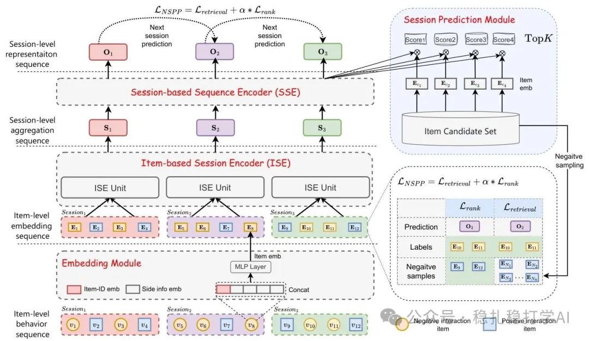

# Recommendation papers (2025.2.17): Meituan SessionRec turns generative sequential recommendation from next-item into next-session prediction
> [中文版](2025-02-17-meituan-sessionrec.md)

> Source: WeChat post https://mp.weixin.qq.com/s?__biz=MzkzNDYyNjM1NA==&mid=2247484154&idx=1&sn=8f21bd9302b484f856855241759ca345&scene=21#wechat_redirect, published 2025-02-17.
> Split from the roundup "Must-read recommendation papers! Recommendation borrows deeply from DeepSeek for the first time, starting a journey of innovation"; same issue: [NetEase Cloud Music resource-optimal scaling law](../behavior-sequence-modeling/2025-02-17-netease-resource-optimal-scaling.full.en.md), [Meituan SessionRec](../generative-recommendation/2025-02-17-meituan-sessionrec.full.en.md), [JD hybrid cross-stage pre-ranking](../loss-func/2025-02-17-jd-pre-ranking-ssb.full.en.md).

SessionRec: Next Session Prediction Paradigm For Generative Sequential Recommendation

Link: https://arxiv.org/pdf/2502.10157

Company: Meituan

Area: generative sequential recommendation

Overview: The session is a very important concept in recommender systems. This work turns the item2item recommendation of sequential recommendation into session2session recommendation. Specifically, sequential recommendation predicts the next item from the sequence over a past period, whereas session recommendation predicts all the items in the next session from the past several sessions.

Through hierarchical sequence aggregation (intra-session / inter-session), it introduces a session-aware representation learning method that lowers the computational complexity of attention while implicitly modeling a large number of negative interactions. In addition, the framework uses a session-based prediction objective: predicting multiple items in the next session simplifies downstream tasks.

Credibility: production.

Recommendation: worth reading.

