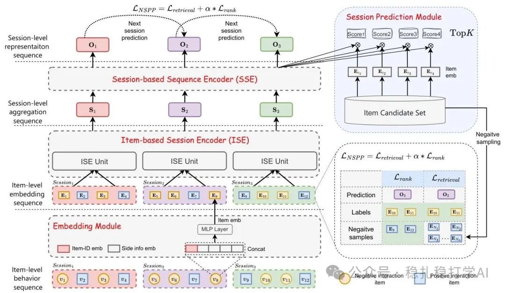

# 推荐算法(2025.2.17)：美团 SessionRec 把生成式序列推荐从预测下一个 item 改为预测下一个 session

> 原文：https://mp.weixin.qq.com/s?__biz=MzkzNDYyNjM1NA==&mid=2247484154&idx=1&sn=8f21bd9302b484f856855241759ca345&scene=21#wechat_redirect
> 作者：算法工程师刘明星（稳扎稳打学AI）| 发表于 2025-02-17
> 本文拆自《推荐算法paper必看！推荐界首次深度借鉴 DeepSeek，开启创新探索之旅》，同期 3 篇：[网易云音乐资源最优 Scaling Law](../behavior-sequence-modeling/2025-02-17-netease-resource-optimal-scaling.md)、[美团 SessionRec](../generative-recommendation/2025-02-17-meituan-sessionrec.md)、[京东跨阶段协同粗排](../loss-func/2025-02-17-jd-pre-ranking-ssb.md)。

关注我，每天为你精挑细选最优质、最新鲜的推荐算法paper，陪你一起保持进步、不断精进！

> [English version](2025-02-17-meituan-sessionrec.full.en.md)

SessionRec: Next Session Prediction Paradigm For Generative Sequential Recommendation

网址：https://arxiv.org/pdf/2502.10157

公司：美团

方向：生成式序列推荐

解读：session是推荐系统里面，一个很重要的概念。这个工作，是把序列推荐中的item2item的推荐，转变为session2session的推荐。具体地说，序列推荐是根据过去一段时间的序列，预测下一个item。而session推荐，则是根据过去几个session，预测下一个session里面的所有item。

通过分层序列聚合（会话内 / 会话间）引入了一种会话感知的表示学习方法，在降低注意力计算复杂度的同时，能够对大量负向交互进行隐式建模；此外，该框架还采用了基于会话的预测目标，通过在下一会话中进行多物品预测，简化了下游任务。

可信度：生产。

推荐等级：推荐看看。

