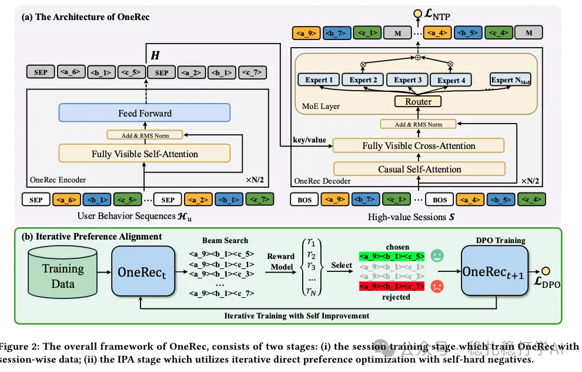

# Recommendation papers (2025.2.27): Kuaishou OneRec unifies retrieval and ranking with generative recommendation
> [中文版](2025-02-27-kuaishou-onerec.md)

> Source: WeChat post https://mp.weixin.qq.com/s?__biz=MzkzNDYyNjM1NA==&mid=2247484205&idx=1&sn=2bf96b05ea4f2bd60b47d4b28923cb8f&scene=21#wechat_redirect, published 2025-02-27.
> Split from the roundup "Recommendation papers (2025.2.27) quick look! New tricks from Kuaishou and Meta! DeepSeek really applied"; same issue: [Kuaishou OneRec](../generative-recommendation/2025-02-27-kuaishou-onerec.full.en.md), [Meta training-free data augmentation](../llm4rec/2025-02-27-meta-training-free-augmentation.full.en.md), [NEC MixLLM dynamic routing](../ml-infra/2025-02-27-nec-mixllm-routing.full.en.md).

OneRec: Unifying Retrieve and Rank with Generative Recommender and Preference Alignment

Link: https://arxiv.org/pdf/2502.18965

Company: Kuaishou (Guorui Zhou's team)

Area: generative recommendation + behavior sequence (session sequence)

Overview: Generative recommendation that merges retrieval and ranking into one: given the historical session sequence, predict the next session.

Since it is generative recommendation, it naturally borrows techniques from large language models, such as DeepSeek's MoE structure and direct preference optimization (DPO).

Takeaways: This is another application of DeepSeek, closer to DeepSeek than the NetEase one. To keep latency low enough, the weights of each module in the implementation must be small, nothing like a large model. As the paper says, to keep performance, only 13% of the weights are used per request. The innovation is also very natural and "naive" (meant as a compliment); fellow practitioners in the industry, keep it up.

Credibility: production

Recommendation: worth reading

