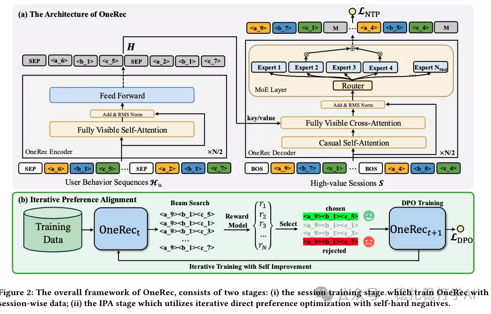

# 推荐算法(2025.2.27)：快手OneRec用生成式推荐统一召回与排序

> 原文：https://mp.weixin.qq.com/s?__biz=MzkzNDYyNjM1NA==&mid=2247484205&idx=1&sn=2bf96b05ea4f2bd60b47d4b28923cb8f&scene=21#wechat_redirect
> 作者：算法工程师刘明星（稳扎稳打学AI）| 发表于 2025-02-27
> 本文拆自《推荐算法paper（2025.2.27）速看！快手、meta又出黑科技！deepseek真应用》，同期 3 篇：[快手 OneRec](../generative-recommendation/2025-02-27-kuaishou-onerec.md)、[Meta 免训练数据增强](../llm4rec/2025-02-27-meta-training-free-augmentation.md)、[NEC MixLLM 动态路由](../ml-infra/2025-02-27-nec-mixllm-routing.md)。

关注我，每天为你精挑细选最优质、最新鲜的推荐算法paper，陪你一起保持进步、不断精进！

> [English version](2025-02-27-kuaishou-onerec.full.en.md)

OneRec: Unifying Retrieve and Rank with Generative Recommender and Preference Alignment

网址：https://arxiv.org/pdf/2502.18965

公司：快手的周国瑞团队

方向：生成式推荐+行为序列（session序列）

解读：召回排序合为一体的生成式推荐——根据历史session序列，预测下一个session。

即然生成式推荐，肯定要借鉴了大语言模型的一些技术，如deepseek的moe结构，直接偏好优化（DPO）等。

心得：这是deepseek的又一个应用。比网易那个，更贴近deepseek哈。为了保证latency足够小，实现的时候，各个模块的weights量应该是很小，跟大模型的不能比的。就如paper里所说，为了保证性能，每次请求只有13%的weights使用到。这个创新也是很natural、naive（褒义），业界同行小伙伴们都要加油了。

可信度：生产

推荐等级：推荐看看

